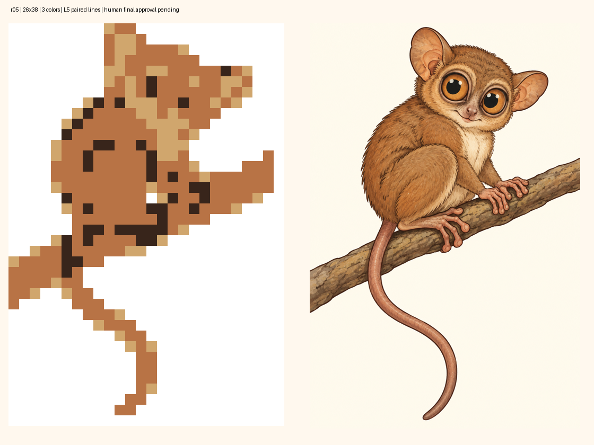

# Koboldmaki · r05 · Endabnahmevorlage

**26×38 ·3 Farben ·988 Zellen ·348 Füllungen. L5: linienübergreifend / besonders hoher logischer Anspruch.**

[Exakte Gitteransicht](final-raster-grid.png) · [vollständiges Paket](package.zip) · [technische ZIP-Inspektion](inspection.json) · [Handoff](handoff.json)

Die sechs gezielten Rasteransätze wurden verglichen. Die gewählte größere Fassung verwendet angepasste warme Palettenanker innerhalb der genehmigten3/4-Farbrollen; nach Entfernung der unbenutzten Bernsteinfarbe bleiben drei tatsächlich verwendete Farben. Die eigene Irisfarbklasse entfällt, beide dunklen Pupillen bleiben. Oberschenkelbögen und der tatsächliche leere Greifraum sind sichtbar; Finger und kleine Zwischenräume bleiben abstrahiert. Abschlussbild und Motivdatei wurden nicht verändert.

Unabhängig geprüft: Herkunft/Normalisierung/Matrix/Hinweise, Randformel, vollständiger Paarlinienproof, separat unvollständige Linienbaseline, Eindeutigkeit und exakte Endmatrix.5 informative Paarschritte, insgesamt260 Proofschritte. Die ZIP-Inspektion meldet `technical=true`; ausschließlich die echte menschliche Endabnahme fehlt. Schwierigkeit0.2 instrumentiert R4, keine vollständige R0–R3-Einstufung oder menschliche Kalibrierung. Spielzeit nicht geschätzt; Probespiel optional/nicht durchgeführt. Keine Rasterreparatur erforderlich. Keine Spielregistrierung.

## Bindung der gewünschten Endabnahme

Eine Erklärung wie „Ich nehme das Paket r05 samt Endraster und Abschlussbild ab; führe Standardauftrag4 aus“ bezieht sich auf genau diese Vorlage und die folgenden unveränderlichen Dateien. Sie wurde noch nicht erteilt.

- Paket-SHA-256: `ded89f5cbcb3d35c53174c22aede6a9b88e1e598d35da97348894ce05eb2d8b9`
- Originalhandoff-SHA-256: `be947d0ca776e79d2f9840a3e31ca37824a65281aa8f3076ffcac91235da3698`
- Originalinventar-SHA-256: `ecf958759cef069eeab6ad0d235696eade60dd886ae617a3d2e6d0a98cc3145f`
- Variante: `area`
- Matrixhash: `a7356562a4155b41f1766fce1e1d23e9c76d5b9e1385c52d4fb229fcdf68edff`
- Logikhash: `3c3a8581fd36c409126854def9ae543a9cb09cff7c96fc0be644b2a58821b818`
- Abschlussbild B-r01 SHA-256: `38ae36da53346a92ef6d9bccb1146ccf8a152593594405ce28d0a7d1d40322ea`

Der ausführliche Bericht, sämtliche Kandidaten und Proofbelege liegen im ZIP. Die Ablagefreigabe und grüne Pfad-/Modus-CI ersetzen diese menschliche Inhaltsabnahme nicht. Nächster Schritt: **4 · Abnehmen & ins Spiel integrieren**.
