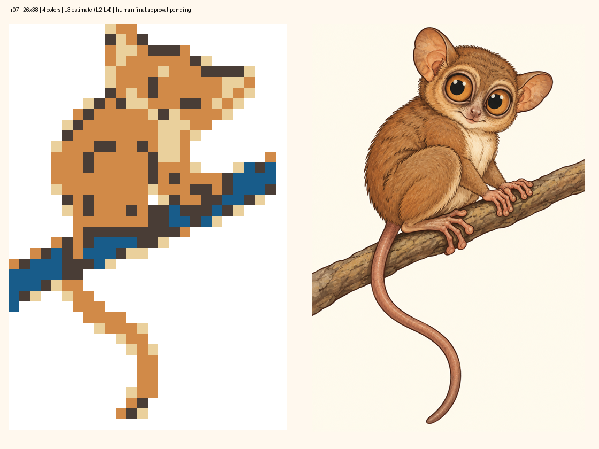

# Koboldmaki · r07 · Endabnahmevorlage

**26×38 ·4 Farben ·988 Zellen ·356 Füllungen. L3 geschätzt, plausibel L2–L4, low.**

[Exakte Gitteransicht](final-raster-grid.png) · [vollständiges Paket](package.zip) · [technische ZIP-Inspektion](inspection.json) · [Handoff](handoff.json)

Ast und Tier sind jetzt klar getrennt: kühles Blau für den Ast, Orangebraun für Körper/Greiflappen/Schwanz, helles Creme und dunkles Braun. Alle vier Farben werden tatsächlich verwendet. Die vier Ausgangsimporte zeigten blaue Mischpixel an Körperkonturen; zwei vorab begründete zusätzliche Ankerpaletten beheben das bei unveränderten Bildbytes, Pose, Dimensionen und vier Farbrollen. Die ausgewählte Fassung bewahrt mehr warme Binnenfläche als die zweite Zusatzvariante. Keine Rasterreparatur oder manuelle Zelländerung. Beide freigegebenen Bilder und der Parameterkorridor unverändert.

Kopfneigung, versetzte Augen, Ohren, Sitzsilhouette, Oberschenkelgliederung, diagonaler Ast, tatsächlicher leerer Greifraum Z17/S14 und S-Schwanz bleiben. Irisringe/Gesicht stark abstrahiert; Finger/Zehen zu Greiflappen reduziert. Astkanten enthalten neben Blau auch dunkle/helle und vereinzelte warme Mischpixel, während die blaue Fläche exklusiv am Ast liegt. Der natürliche braune Ast des detaillierten Abschlussbilds entspricht der genehmigten blauen Motivabstraktion. Keine Farbblindheits-/Zugänglichkeitszertifizierung behauptet.

Unabhängig geprüft: Herkunft/Normalisierung/Matrix/Hinweise, Randformel, vollständiger full-line-color-Proof vom unbekannten Start ohne Raten, Eindeutigkeit und exakte Endmatrix.227 Proofschritte; alle64 Linien vor jedem Schritt auf Fortschrittsmöglichkeiten geprüft, mindestens3 produktive Linien vor Restaufräumen. R2 geschätzt prägend; keine formale R0–R3-Notwendigkeitsklassifikation oder menschliche Kalibrierung. Spielzeit nicht geschätzt; Probespiel optional/nicht durchgeführt. ZIP-Inspektion `technical=true`; ausschließlich die tatsächliche menschliche Endabnahme fehlt. Keine Spielregistrierung.

## Bindung der gewünschten Endabnahme

Eine Erklärung wie „Ich nehme das Paket r07 samt Endraster und Abschlussbild ab; führe Standardauftrag4 aus“ bezieht sich auf genau diese Vorlage und die folgenden unveränderlichen Dateien. Sie wurde noch nicht erteilt.

- Paket-SHA-256: `6b37c6e0dd44f20d01ed51286ffed5429f7f4a7654bf9089403aec5b1dca5c99`
- Originalhandoff-SHA-256: `8c9fab952888470ea3a7377d8c88df77181f959d68cc8c7740cd5c1f7457df1a`
- Originalinventar-SHA-256: `15d7374df4ae85f9eb4d01b177d315697bb658016aeda9fd0e59dc55f23a932f`
- Variante: `area`
- Matrixhash: `9d89385688bd4bb83beb7dc46a52e4514d08fdab8355ee1e1e61104b371d979b`
- Logikhash: `5af35f42cbc447ce3daa5dc1f8a0257c88230e9bbcd1c70ae34d1d54157db260`
- Abschlussbild B-r01 SHA-256: `38ae36da53346a92ef6d9bccb1146ccf8a152593594405ce28d0a7d1d40322ea`

Bericht, sämtliche Kandidaten und Proofbelege liegen im ZIP. Die Ablagefreigabe und grüne Pfad-/Modus-CI ersetzen nach PUZZLE_AUTHORING§3/§8 diese gesonderte menschliche Endabnahme nicht. Nächster Schritt: **4 · Abnehmen & ins Spiel integrieren**.
