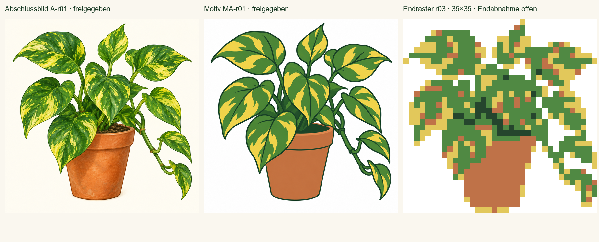

> Historische Endabnahmevorlage aus Standardauftrag 3. Die inzwischen erteilte Endfreigabe und aktuelle Registrierung stehen im [Integrationsbericht](INTEGRATION.md).

# Efeutute r03 · Endabnahmevorlage

`pz-8ea7f3dacdcc428a9fcff7a735bc` · **content_ready** · 13.10.2026 · Regelwerk 0.4.1, Dokumentrevision 5.
Toolcommit `ac3d1b504c3cbab9480e29764bbc107a4cbec470`, Basis `f666f87d36a0ea7fa3740202d08706f2215bc303`.
Branch `authoring/efeutute-selection`, [Draft-PR #108](https://github.com/venomenon328/picross/pull/108).

**Auswahl:** `a-center`, 35×35 = 1.225 Zellen, vier Vordergrundfarben plus Leer;
733 gefüllt / 492 leer. Palette Dunkelgrün `#25452d`, Grün `#508943`, Gold `#e2c85b`,
Terrakotta `#bf7248`, Leer Weiß. Vier verschiedene Kandidaten, zwei zertifiziert,
zwei bestätigte unvollständige Fixpunkte. Gewählt wegen vollerer Blattflächen und
besser geschlossener rechter Ranke; keine Reparatur, kein Zell-Diff.

**Alle acht Inhaltsgates bestanden:** Abschlussbild-/Motivfreigabe, Herkunft,
Logik, Randregel, Gestaltung, Schwierigkeit und Revealkonsistenz. Produktmaße gültig;
alle vier Kanten belegt. Quelle/Normalisierung/Matrix/Hinweise frisch rekonstruiert,
vollständiger `full-line-color`-v1-Proof vom unbekannten Start ohne Suche, frische
unabhängige Prozessprüfung und exakte Endmatrixgleichheit bestätigt.
[ZA-1-Prüfung des geschriebenen ZIPs](inspection.json): `technical=true`,
einziger Blocker fehlende menschliche Endabnahme. [Dateiprüfung](validation.json).

**Schwierigkeit L3**, plausibel L2–L4, `picross-difficulty-0.1`, `editorial_estimate`,
Vertrauen `low`: Überlappungsanker aus eng gepackten Farbfolgen, voraussichtlich
kombinierte Zuordnung kurzer Blattblöcke. Keine initialen R0-Voll-/Leerlinien;
mindestens zehn produktive Linien vor Restaufräumen, keine definierte Engstelle
in 190 geprüften Wissensständen. Schwächere Regelfamilien nicht erschöpfend
geprüft. Bearbeitungsumfang 1.225 Zellen, Lösungszeit nicht geschätzt.

**Sichturteil:** Motiv, Pose, Hauptblätter, Topf und Seitenranke erhalten.
Weiche Ausnahmen: eine isolierte diagonale goldene Blattspitze, 82 einzelne
Farbbinnenzellen, reduzierte Konturen/Adern und wenige Terrakottatöne an Blatträndern
aus Flächenmittelung. Kein materieller Motivwechsel; keine offene Inhaltskorrektur.
Nutzungsgrundlage: native OpenAI-Bilder im Nutzerauftrag ohne fremde Bildreferenzen.
Diese Phase 0 Bildaufrufe, 4 Imports, 0 Reparaturen; insgesamt 4 Bildaufrufe;
aktive Menschenzeit nicht erfasst. Probespiel optional und nicht durchgeführt.

[Paket](package.zip) (15,554,553 Bytes), [Handoff](handoff.json), [Record](record.json).
ZIP-SHA-256: `297d5375e1337760b503742945c47f1ebf22db2308659d28a0e0d7289e6d8b39`.
**Inventar-SHA-256: `e66d8ca4e0b324589fe24f0289d8b9ad8f224005298296b933e8d2cb950603c8`.**
Alle technischen Bündel, Originalbilder, Prompts, Freigaben, Bewertungen und
Rasteransichten sind im ZIP; ausführlicher Belegindex dort in `report.md`.

A-r01 und MA-r01 sind tatsächlich freigegeben. **Endabnahme steht aus.**
Export und Spielregistrierung sind noch nicht ausgeführt. Nächster erlaubter Schritt:
Endabnahme dieses r03-Inventars. Mögliche Erklärung: „Ich gebe Efeutute r03 mit
Kandidat a-center und Abschlussbild A-r01 in der vorgelegten Endabnahmevorlage frei.“
Ein anschließender Standardauftrag 4 benötigt einen Integrationsauftrag. Kein Merge.
