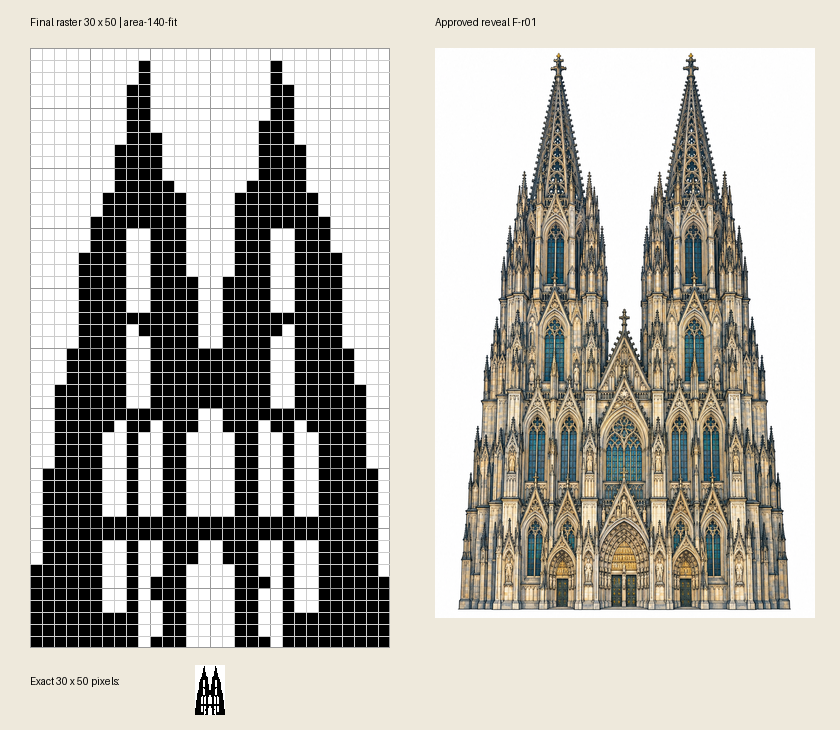

# Kölner Dom r04 – Endabnahmevorlage

**30 × 50 Mono · 1500 Zellen · 747 gefüllt · content_ready · 14.10.2026 (Europe/Berlin).** Kategorie Gebäude & Bauwerke. Regelwerk 0.4.1/Dokumentrevision 5; Toolcommit `149f3d9e2fda926fc36843f7e4ee2856c31fe3ea`.

Ausgewählt `area-140-fit`: **ohne Reparatur vollständig deduktiv lösbar und eindeutig**, `full-line-mono` v1, 126 unabhängig geprüfte Schritte. Herkunft, Hinweise und exakte Endmatrix bestanden. Links/rechts/unten belegt; obere Leerzeile zulässig. Sechs gezielte, verschiedene Kandidaten; erste vier wegen Randregel, fünfter wegen isolierter Turmspitzen verworfen. Weißraumcrop exakt 3:5 ohne Streckung. Gleich hohe zusammenhängende Türme, offener Zwischenraum, Mittelgiebel, Fenster und drei Portale erhalten; kleine Ornament-/Bogen-/Schwellendetails rasterbedingt reduziert. Keine weichen Ausnahmen.

**Schwierigkeit L2 (leicht), plausibel L2–L4**, Methode `picross-difficulty-0.1`, `editorial_estimate`, Vertrauen `low`. Lange Blocküberlappungen liefern breite Fortschritte; vor Aufräumen mindestens 16 produktive Linien. R1-Suffizienz/R2-/R3-Notwendigkeit nicht vollständig validiert. Bearbeitungsumfang 1500 Zellen; Lösungszeit nicht geschätzt, aktive Menschenzeit nicht erfasst. Probespiel optional/nicht durchgeführt.

F-r01 ausdrücklich freigegeben; Nutzerfreigabe „Motivvorlage r03“ an die eindeutige enthaltene Datei MA-r02 gebunden. Beide Bilder bleiben bytegleich. Nutzungsgrundlage: beauftragte KI-Illustration und Ableitung ohne Fremdassets; Prompts und bekannte Einstellungen im Paket. Aktuell keine Bildaufrufe, zwei Imports/sechs Raster, keine Reparatur. **Endabnahme offen**. ZA-1 auf geschriebenem ZIP: technisch bestanden; Export/Registrierung nicht ausgeführt, Katalogbereitschaft nicht behauptet.

[Originalpaket r04](package.zip) · [exaktes Raster-PNG](raster.png) · [Handoff](handoff.json) · [geschriebene ZIP-Inspektion](inspection.json) · [getrennter Selbstreview](self-review.json) · [Record](record.json).

| Bindung | SHA-256 |
| --- | --- |
| Inventar | `5714eb711cf258cca33c7e182a833a69bf6b38cefc2710e4bad21d63b888adea` |
| ZIP (7.942.005 Bytes) | `7c0f588870e0c4a5e465a8c672d8062e970e252aac24535e1f24137aa656e2f2` |
| Originalhandoff | `a8b755a054582b3992dca53451deb935228a68d74ef7ee258580c1eb608effe6` |
| Endmatrix (kanonisch) | `589d177cf134a9a7bc0adfbcd17a8c0a86663db4dac9a21cfe1778ea3ea69666` |
| Logikeingang (kanonisch) | `b12f4f7cf1403cc71e80faa6307f3de9814636a107bb34f37f2bda1b3891ad1d` |
| Abschlussbild F-r01 | `8325ef5ee94d88312b968ad058f6cddcf35cda68946db7e9598a97f26ac17998` |

Belege im ZIP: `approvals/reveal-approval.json`, `approvals/motif-approval.json`, `audit/source-validation.json`, `audit/origin-verification.json`, `audit/final-verify.json`, `audit/final-checks.json`, `audit/visual-review.json`, `audit/candidate-comparison.json`, `difficulty.json`, `audit/difficulty-checkpoints.json`, `decisions.json`, `effort.json` sowie vollständige RP-3-Bündel unter `production/import-r01` und `production/import-r02`. Finale Ansichten unter `views/`; Originalabschlussbild unter `reveal/F-r01.png`.

Nächster erlaubter Schritt: Nutzer nimmt genau **r04 samt obigem Inventar** redaktionell ab. Diese Erklärung anschließend separat sichern; bei enthaltenem Integrationsauftrag folgt Standardauftrag 4. Eigener Selbstreview ist keine unabhängige Zweitprüfung. Draft-PR #112, kein Merge; keine Spielregistrierung.
