# AT-B: Gebundene Bestandsbilder – Übernahme und AT-B-T01

## Aktueller Stand: AT-B-F01 nach Eigentümerabnahme

**Alle 26 Start-IDs haben eine neue freigegebene und auf dem Arbeitsbranch
integrierte Bildrevision 1.** Die [gemeinsame Eigentümerabnahme](AT_B_OWNER_APPROVAL.md)
bindet unverändert die am Head `2100f1a780fa64fe499111c4022ebed5fe7d83c7`
vorgelegten Dateien. Keine offene oder ausgelassene Start-ID. Der ursprüngliche
V01-Haltepunkt ist damit erfüllt; der folgende V01-Bericht bleibt als historischer
Lieferstand erhalten. Seine damals offenen Freigaben und Übernahmeschritte
werden durch diesen aktuellen Abschnitt fortgeschrieben.

Basis bleibt `a0cb25eda49d29d3062fd3bcfeab9fda220c7aa9`; Branch
`chore/256-transparente-bestandsbilder`, [Draft-PR #264](https://github.com/venomenon328/picross/pull/264).
Die Eigentümererklärung und der AT-B-F01-Folgeauftrag wurden vor dem ersten
Plan im vollständigen aktuellen Body von [#256](https://github.com/venomenon328/picross/issues/256)
gesichert. Die 26 separaten `approval.json` und aktiven AT-Records enthalten
die tatsächlichen drei Zustimmungen. Der UTC-Wert ist ausdrücklich die Zeit
der Protokollierung; ein ursprünglicher Nachrichtenzeitpunkt ist nicht verfügbar.

### Kontrollierte Übernahme und identische Wiederholung

Eingang und Planverzeichnisse lagen außerhalb des gesamten Checkouts und
außerhalb voneinander. Drei lexikografische Teilmengen 9/9/8 halten die
gemeinsamen Bildseiten jeweils unter 32 MiB; keine angehobene Grenze.
Vor jeder Übernahme wurden IDs, Definition/Vorgänger/Neubild/Notice, echte
Freigabe, Revision 0→1 und die exakte Schreibmenge gegen die versiegelte
Vorlage geprüft. Die PNGs gelangten ausschließlich über den vorhandenen
`catalog_reveal`-Weg an ihre bisherigen aktiven Pfade.

| Block | IDs | Alte und neue PNG-Bytes | Planhash | Ergebnis |
| --- | --- | --- | --- | --- |
| 1 | 9 | 30.434.093 | `975e9641ca79ba214edc2b157080792234f65ab235680a235bc9ddefede59e46` | 27 Ziele übernommen, unmittelbare Wiederholung No-op |
| 2 | 9 | 33.337.064 | `b0d9cf6138ccbeed1fffe8fa567d202276c1831bf952786e4f0fd683d4c4b51f` | 27 Ziele übernommen, unmittelbare Wiederholung No-op |
| 3 | 8 | 30.913.835 | `8fea577fa64fb9be882e374e1828159d6e31129ce55c224aedea22a755ab30fa` | 24 Ziele übernommen, unmittelbare Wiederholung No-op |

[Block 1](design/at_b_integration/audit-01.json),
[Block 2](design/at_b_integration/audit-02.json),
[Block 3](design/at_b_integration/audit-03.json) sichern die tatsächlichen
Schreibpfade. Je Block sind Plan, vollständige CLI-Ergebnisse für Plan/Adopt/No-op
und geprüfte Zielhashes daneben abgelegt. Die Plan-JSONs sind Auditkopien;
die externen ausführbaren Planverzeichnisse enthalten zusätzlich alte/neue PNGs.
Deren identische Bytes bleiben in den versiegelten `at-b-r01`-Ablagen gesichert.
Die Auditkopie allein ist kein erneut auszuführender CLI-Eingang.

Jede Übernahme änderte exakt Bild, Notice und neuen AT-Record je ID. Alle anderen
Dateien unter `content/` und `game/` blieben nach SHA-256, Größe und `mtime_ns`
gleich. Unmittelbar danach erhielt der identische zweite `adopt` den vollständigen
Dateisnapshot byte-, größen- und zeitstempelgleich; leere Änderungsliste,
kein Journal/Lock und kein Recoverybedarf. Die drei neuen Pläne wurden jeweils
erst nach dem vorigen abgeschlossenen Block erstellt.

### Integrität und Authoringablage

[Gemeinsame Dateikontrolle](design/at_b_integration/invariants.json): 78 aktive
Ziele, alle 26 Bild-/Noticebytes exakt wie freigegeben, alle aktiven Records
mit Bild-/Bindungsrevision 1 und exakter Freigabe. Die übrigen **321 geschützten
Dateien** des 373-Dateien-Ausgangsinventars sind unverändert: Definitionen,
Runtime-Revisionen, Registryprojektionen, Identitäten/Slots/Pfade, Ratings,
Hinzugefügt-Metadaten und ursprüngliche Integrationsbelege. Die entfernten
52 Positionen des Vergleichs sind ausschließlich PNG und ergänzte Notice je ID.
Echte Spielstände wurden nicht geöffnet oder verändert; keine neue Logik-,
Proof-, Schwierigkeits- oder Rasterproduktion.

Alle 26 ZIPs, Inventare, Handoffs, ursprünglichen Freigabevorlagen und gebundenen
Regelwerkskopien sind bytegleich zum vorgelegten V01-Stand. Die ZIPs wurden
erneut gelesen und alle enthaltenen Einträge gegen ihre Einzeldateien geprüft.
Nach Authoring §6.1 stehen die spätere Freigabe und Integration ausschließlich
in separater `approval.json` und äußerem `record.json`. Dessen `registered`
bezeichnet den Arbeitsbranch; keine neue ZA-1-Adapterzertifizierung oder
Integration auf `main`. Das aktuelle Regelwerk führt Dokumentrevision 22,
die versiegelten Pakete unverändert Revision 21.

### Tatsächliche Katalog- und Abschlussansichten

Die einmalige redaktionelle Integrationsprobe verwendet die tatsächliche
unveränderte Anwendung mit den 26 übernommenen PNGs: Godot
`4.7.2.stable.official.ed1daf0bf`, Windows/OpenGL3, 1920×1080, UI100 und UI125.
Die offizielle Editor-ZIP wurde gegen SHA-256
`731980f9608d61333e5baf54a2ef17210acc7a538446c0cb9969f002aca1e953`
geprüft. Eine frische externe Projektkopie wurde neu importiert; AppData,
LocalAppData und Saveziel lagen ausschließlich im isolierten Prüfverzeichnis.

Für die Sichtkontrolle wurden gelöste **Darstellungszustände vorbereitet**;
dies ist kein Durchspielen, Solverlauf, Savewechsel- oder Lebenszyklusnachweis.
Jede Karte wurde in ihrer echten Kategorie vollständig in den sichtbaren Bereich
gescrollt. Je ID und Skalierung wurden Katalogkarte und tatsächliche
Abschlussansicht aufgenommen: **104 originale Engine-PNGs**.
[Aufnahmeinventar](design/at_b_integration/native/captures.json),
[Datei-/Enginebindung](design/at_b_integration/native/bindings.json),
[Sichtkontrolle je ID](design/at_b_integration/visual-review.json).
Der separat abgelegte einmalige Aufnahmeskripttext ist kein neuer Test oder
Bestands-Replay in CI. Ableitungen für die Sichtprüfung verändern keine Assets;
die originalen vollständigen Frames bleiben erhalten.

Alle 26 Motive wurden bei beiden Skalierungen visuell kontrolliert: tatsächliche
Papierdurchsicht, Aussparungen, helle Motivteile, Konturen, Lesbarkeit und
Szenenkomposition. Kein durch die Integration hinzugekommener deckender
Bildkasten oder Motivbeschnitt festgestellt. Die bereits freigegebenen
Texturunterschiede und teils leicht durchlässigen Motivpixel bleiben erhalten.
Die technischen Hover-/EA-/Save-/Browserregressionen werden durch die aktuelle
synthetische Pflicht-CI geprüft; die statischen nativen Aufnahmen behaupten
diese Abläufe nicht.

### Aktuelle Pflicht-CI, Selbstreview und verbleibendes Gate

Der gesamte PR enthält weiterhin die gesondert autorisierte technische
CI-Nacharbeit `2100f1a`. Daher wählt die unveränderte CI regulär **alle acht Jobs**,
einschließlich sieben nativer Gruppen und fünf Chromiumgruppen mit 30 aktuellen
Szenarien. Reine Inhaltsprüfung ist für diesen Gesamtdiff nicht anwendbar.
Der finale PR-Abschlussnachweis bindet den tatsächlichen Integrationshead,
Basis, Test-Merge, Run/Versuch und Auswahl-/Ergebnisartefakte. Der frühere grüne
Run `39322268252` belegt ausschließlich den damaligen Vorlagenhead.
Der aktuelle CI-Stand und das **getrennte Selbstreview AT-B-F01-SR01** stehen
im PR; dieser Bericht behauptet keinen späteren Lauf vor dessen Abschluss.

Das separate Vorlagenreview `AT-B-V01-R01 · R1` vom 19.10.2026 am Head
`2100f1a` hatte keine blockierenden Befunde. Dessen A01 ist durch die tatsächliche
Eigentümerabnahme erfüllt; A02 durch die hier belegte Übernahme samt AT-B-T01
und dem aktuellen CI-/Selbstreviewabschluss. **A03 bleibt offen:** qualifiziertes
separates finales AT-B-R01 am Integrationshead vor einer neuen Mergeentscheidung.
PR #264 bleibt Draft, #256 offen. Kein Merge, Deployment, Cleanup oder Issue-Abschluss.

## Historischer AT-B-V01-Lieferstand vor Eigentümerentscheidung

Die folgenden Abschnitte dokumentieren den damaligen Vorlagenstand und seine
damals offenen Gates. Maßgeblich für die erfolgte Freigabe und Übernahme ist
der aktuelle AT-B-F01-/AT-B-T01-Abschnitt oben.

## Stand und Entscheidungsgrenze

**V01-A06: aktuelle Pflicht-CI und getrenntes Selbstreview im PR-Abschlussnachweis.**
[Run 39319698291, Versuch 2](https://github.com/venomenon328/picross/actions/runs/39319698291/attempts/2)
auf Bildlieferhead `b5efb3dcff0a637b65cdef830a4aa3270908c7ce` scheitert wie Versuch 1
am 90-Sekunden-Limit von `git diff --check` im partiellen Checkout, vor den Tests.
`docs` und `ci-required` sind fehlgeschlagen; übrige Jobs übersprungen, kein
CI-Auswahlbeleg erzeugt. Der lokale erfolgreiche Check ersetzt diese Pflicht-CI nicht.
[Selbstreview AT-B-V01-SR01 R1 / B01](https://github.com/venomenon328/picross/pull/264#issuecomment-6276723787)
bindet den ursprünglichen Befund. Der nachfolgende Dokumentationshead
`c6e887c1f5ccf53038c6e21116c2cd5e1de1c810` scheiterte in
[Run 39320576016 / Versuch 1](https://github.com/venomenon328/picross/actions/runs/39320576016)
am selben Abrufproblem. Diese fehlgeschlagenen Runs bleiben fehlgeschlagen.
V4 erlaubt allein keine Selector-/Harnessänderung; der Eigentümer hat danach
ausdrücklich **„Separate CI-Nacharbeit erlauben“** erklärt. Die unten beschriebene
eng begrenzte B01-Korrektur ist damit zusätzlich beauftragt und als eigener
Nacharbeitscommit geliefert. [Draft-PR #264](https://github.com/venomenon328/picross/pull/264)
führt den finalen Head, die aktuelle CI-Bindung und das getrennte Selbstreview.
Erst deren erfolgreicher aktueller Nachweis erfüllt A06; lokale Tests allein nicht.

**AT-B-V01 aus Issue #256 / Umsetzungsvorbereitung V4.** Alle 26 aktiven
Bestandsmotive liegen als transparente native Bildrevisionen, Einzeldateien und
gesicherte Authoringpakete zur gemeinsamen Bild-/Endfreigabe vor. Noch keine
Eigentümerfreigabe und keine aktive Bildübernahme. Alle 26 Dispositionen:
**Kandidat vorgelegt; Bildannahme, Motiv-/Rasterkonsistenz und redaktionelle
Endabnahme ausstehend.** Keine ID als bereits konform oder integriert gezählt.

Branch: `chore/256-transparente-bestandsbilder`, Ziel `main`.
Start-/Vergleichsbasis: `a0cb25eda49d29d3062fd3bcfeab9fda220c7aa9`,
Tree `ebaacd05225b01d5ca8a84440da3796ebaac1474`.
Der Draft-PR führt `Refs #256`; V01 ist kein separat zu mergender Teilstand.
Der finale Head und die aktuelle CI-/Reviewbindung werden im PR-Abschlussnachweis
geführt; eine CI-Ausführung kann nicht ihren eigenen späteren Berichtcommit prüfen.

**Haltepunkt vor jedem `catalog_reveal plan` und `adopt`.** Es gibt weder einen
produktiven Request/Plan noch ein `picross-reveal-approval-v1`-Objekt. Die eigenen
`approval-proposal.json` sind ausdrücklich Vorlagen, mit Akteur, UTC, Erklärung
und allen drei Zustimmungen `null`. `test_only=false` ist keine Zustimmung.
Die Paketrevision `at-b-r01` ist von der vorgeschlagenen **AT-Bildrevision 1**
zu unterscheiden. Bisher fehlen aktive AT-Records bei allen 26 IDs.

## Quellen, Ausgangslage und Ausführungsweg

Aktuelle AGENTS.md, lokaler Workflow, Projektprofil und vollständiger Issue-Body
V4 samt Kommentaren wurden vor der Bildarbeit gelesen; ebenso AT, Produktdefinition,
Gestaltungskonzept, Rätselproduktion/Authoring, ZA-1, Kategorien, SD-Katalogvertrag,
Werkzeuganleitung, Katalogdarstellung/-sortierung, CI-Policy, Entwicklungsinventar
und die einschlägigen KAT-1/KAT-2/EA/KK/KB-Darstellungsnachweise. Die technischen
AT-Verträge wurden nicht verändert. Historische KU-/SD-Abnahmen bleiben unberührt.

`origin/main` wurde tatsächlich abgerufen und gegen die vorgegebene Basis geprüft.
Kein vorhandener AT-B-Arbeitsstand oder offener AT-B-PR musste fortgesetzt werden.
Inhalts- und Runtime-Registry besitzen dieselben 26 sichtbaren registrierten IDs;
kein Scope-Delta. Die Original-PNGs wurden lokal vollständig gelesen, gehasht und
vor jedem nativen Edit einzeln angesehen: zusammen **50.012.913 Bytes**.
Alle 26 Originale sind deckend. Originaldateien, Definitionen, Noticebytes und
physische Receipts liegen bytegleich im jeweiligen Paket; alte ZIPs/Proofs wurden
nicht rekonstruiert. `source-binding.json` unterscheidet den SHA-256 des physischen
Receipts vom ursprünglichen stabilen Exportanker und bindet Git-Blob, Basis,
Livepfade, Revision, ID/Slot/Kategorie sowie Rating-/Added-/Registryquellen.

Ausgeführt auf der Windows-Workstation mit lokalem Checkout, PowerShell/Git/`gh`,
Python 3.13.14 und Pillow 12.3.0 in einer isolierten Arbeits-venv. Originaldatei-,
Dateischreib-, GitHub-/CI-Lesezugriff und Repositoryrechte waren verfügbar;
Commit/Push/PR belegen den Schreibweg. Die native Bildfunktion wurde mit den
lokalen Originalpfaden tatsächlich verwendet: **27 native Edits** für 26 angebotene
Dateien, einschließlich einer verworfenen Warnemünde-Runde. Keine neue Modell-API,
kein API-Schlüssel und keine algorithmische Freistellung. Modell/Seed/Qualität
sind vom nativen Werkzeug nicht exponiert und werden nicht erfunden.

AT-A ist bereits über [PR #263](https://github.com/venomenon328/picross/pull/263)
integriert. [Main-CI 39309694291](https://github.com/venomenon328/picross/actions/runs/39309694291)
auf der Startbasis wurde beim Start als erfolgreich bestätigt. AT-A-R01 und dessen
historische synthetische Tests sind keine neuen V01-Tests.

## Bildprüfung und Grenzen der Vorlagen

Jedes Original, jeder Kandidat, die 26 Vorher/Nachher-/Rasteransichten und die
relevanten vergrößerten Kanten wurden gesichtet. Katalog- und Abschlusskompositionen
bei UI100/125 wurden für alle 26 Kandidaten geprüft. Helle Motivflächen bleiben
sichtbar, echte Zwischenräume zeigen Papier; keine pauschale Farb- oder Alpharegel
dient als Abnahme. Motive, Blick-/Bewegungsrichtung und prägende Proportionen
bleiben an den aktuellen Bestand gebunden. Feintextur, Kontrast und einzelne
Konturpixel sind durch den nativen Edit nicht RGB-pixelidentisch. Diese Abweichung
ist für die neue Eigentümerentscheidung offengelegt.

Die nativen Ausgaben enthalten echte Alpha-0-Flächen, weiche Konturen und vielfach
Alpha 252–254 statt 255 in Motivflächen. Es erfolgte keine nachträgliche globale
Normalisierung oder Deckkraftänderung. Das vollständige Histogramm ist pro Datei
gesichert. Lichtes Papier ist durch die freigestellten Außenflächen sichtbar;
helle Motivbestandteile wie Bart, Knoblauchschale, Yin-Yang-Hälfte, Schaum und Kragen
bleiben als Motiv erhalten. Das ist eine visuelle Vorprüfung, keine vorweggenommene
Eigentümerannahme oder Garantie pixelidentischer Materialwirkung auf jedem Hintergrund.

Besondere Entscheidungen:

- **Warnemünde:** Außenrandvignette mit erhaltenem blauem Himmel, Sonne, Meer,
  Leuchtturm, Teepott und Platz. Runde 1 verschob Sonne/Proportionen und wurde
  verworfen; Runde 2 entstand erneut aus den Originalbytes mit konkreten
  Positionsvorgaben. Verwerfung und beide Prompts sind gesichert.
- **Brandenburger Tor:** neutraler Außenhimmel und Durchgänge offen; zusammenhängende
  Pflasterinsel läuft außen aus. Quadriga, Säulen und Wandflächen bleiben Motiv.
- **Buntspecht/Koboldmaki/Kaktus:** Stamm, Ast beziehungsweise Sandinsel gehören
  weiter zum Motiv. Vorhandene Anschnitte werden nicht neu erfunden.
- **Carabao:** tatsächlich integrierter Kopf aus r11; keine ältere Ganzkörperfassung.
- **Pfirsich:** native Ausgabe 1263×1246 gegenüber 368×363, annähernd gleiches
  Seitenverhältnis. Keine manuelle Skalierung der angebotenen Datei; sichtbar
  feinere native Textur ist Teil der neuen Vorlage.
- **Windspiel:** der zunächst in der Rohanzeige vermutete Farbschleier lag in
  Alpha-0-Pixeln; in korrekter Papierkomposition keine entsprechende Fläche.
  Kein zusätzlicher Bildlauf. Dunkle Röhreninnenräume und helle Materialreflexe
  sind keine pauschal zu löschenden Löcher.

Die JPG-Belege sind **statische Kompositionen**, keine Engine-Screenshots. Sie
verwenden genau die gehashten PNGs, proportional eingepasst mit Pillow/Lanczos.
Katalog: tatsächliches normales Kartenpapier `#fff8e8`, Bildhöhe `112*u`, gewählte
Referenzbreite `300*u`; alle angebotenen Seitenverhältnisse passen höhengebunden.
Abschluss: tatsächliches Buchasset `game/art/book/bp2-a-inventarband.png`,
1280×720, Layoutformeln des aktuellen `main.gd`, reservierte Titelhöhe `36*u`.
Diese Titelhöhe ist eine dokumentierte Annahme, keine gemessene Godot-Schriftmetrik.
`view-bindings.json` nennt Maße, Bildrechtecke, Papierhash, Ausschnittkoordinaten,
Dateihashes und Grenzen. Das vorhandene Raster wird nur aus der unveränderten
Definitionsmatrix angezeigt; keine Neuproduktion, kein Solver oder neuer Proof.

Echter Import, Runtimefilterung, Hover/Fokus, Spoilergrenzen, Überblendung,
Wiederöffnung und Saveverhalten wurden hier **nicht ausgeführt**. Die spätere
Darstellungskontrolle gehört zu AT-B-T01; AT-A-Nachweise werden nicht umetikettiert.

## Vollständiges Startinventar

Die Originalbindung verlinkt sämtliche aktiven Pfade, SHA-256, physischen Receipt,
historischen Freigabe-/Herkunftsbezug und ursprünglichen Exportanker. Alle neuen
Dateien sind PNG/RGBA; Status jeder Zeile: **Freigabe ausstehend**.

| Motiv / reale ID | Kategorie | Original: Maße, Bytes, Modus | Kandidat: Maße, Bytes | Quellenbindung |
| --- | --- | --- | --- | --- |
| Ho Chi Minh · `pz-023b50b44d1c4698a6e17e65b6ea4337` | `menschen-berufe` | 1086×1448; 2072922; RGB | [1086×1448; 1615316](../content/authoring/pz-023b50b44d1c4698a6e17e65b6ea4337/at-b-r01/reveal.png) | [Bindung](../content/authoring/pz-023b50b44d1c4698a6e17e65b6ea4337/at-b-r01/source-binding.json) |
| Windspiel · `pz-20219e14dbe242689b9ef06297828f34` | `musik-buehne` | 1024×1536; 1591654; RGB | [1024×1536; 1703793](../content/authoring/pz-20219e14dbe242689b9ef06297828f34/at-b-r01/reveal.png) | [Bindung](../content/authoring/pz-20219e14dbe242689b9ef06297828f34/at-b-r01/source-binding.json) |
| Kolibri · `pz-25d245061b0c49c190788de8e5d0e45b` | `voegel` | 1448×1086; 1961165; RGB | [1448×1086; 1241679](../content/authoring/pz-25d245061b0c49c190788de8e5d0e45b/at-b-r01/reveal.png) | [Bindung](../content/authoring/pz-25d245061b0c49c190788de8e5d0e45b/at-b-r01/source-binding.json) |
| Brandenburger Tor · `pz-2a8481f61e6443bda174bd3da67c` | `gebaeude-bauwerke` | 1536×1024; 1870614; RGB | [1536×1024; 1978700](../content/authoring/pz-2a8481f61e6443bda174bd3da67c/at-b-r01/reveal.png) | [Bindung](../content/authoring/pz-2a8481f61e6443bda174bd3da67c/at-b-r01/source-binding.json) |
| Knoblauch · `pz-3a744ae1b7cb4d38b0ac29d030ef` | `gemuese-pilze-kraeuter` | 1254×1254; 1975813; RGB | [1254×1254; 1481354](../content/authoring/pz-3a744ae1b7cb4d38b0ac29d030ef/at-b-r01/reveal.png) | [Bindung](../content/authoring/pz-3a744ae1b7cb4d38b0ac29d030ef/at-b-r01/source-binding.json) |
| Yin-Yang · `pz-3e97c042f0bf474e8608a84ea034c246` | `mythen-fantasie` | 1254×1254; 2416936; RGB | [1254×1254; 2210166](../content/authoring/pz-3e97c042f0bf474e8608a84ea034c246/at-b-r01/reveal.png) | [Bindung](../content/authoring/pz-3e97c042f0bf474e8608a84ea034c246/at-b-r01/source-binding.json) |
| Japanische Teekanne · `pz-51405ea1ad194507a60c9b6701d802f0` | `haushalt-alltag` | 1536×1024; 1958146; RGB | [1536×1024; 2114210](../content/authoring/pz-51405ea1ad194507a60c9b6701d802f0/at-b-r01/reveal.png) | [Bindung](../content/authoring/pz-51405ea1ad194507a60c9b6701d802f0/at-b-r01/source-binding.json) |
| Gecko · `pz-5ad1e06e19ab475baebc582d4999daa5` | `insekten-kleine-tiere` | 1774×887; 1730672; RGB | [1774×887; 1044090](../content/authoring/pz-5ad1e06e19ab475baebc582d4999daa5/at-b-r01/reveal.png) | [Bindung](../content/authoring/pz-5ad1e06e19ab475baebc582d4999daa5/at-b-r01/source-binding.json) |
| Pfirsich · `pz-72561c715dd741f9b0082c7ad24802c1` | `obst-nuesse` | 368×363; 158362; RGB | [1263×1246; 1308501](../content/authoring/pz-72561c715dd741f9b0082c7ad24802c1/at-b-r01/reveal.png) | [Bindung](../content/authoring/pz-72561c715dd741f9b0082c7ad24802c1/at-b-r01/source-binding.json) |
| Koboldmaki · `pz-72eb9b188896440c8a9a833e803835ec` | `saeuger` | 1024×1536; 1815356; RGB | [1024×1536; 1971254](../content/authoring/pz-72eb9b188896440c8a9a833e803835ec/at-b-r01/reveal.png) | [Bindung](../content/authoring/pz-72eb9b188896440c8a9a833e803835ec/at-b-r01/source-binding.json) |
| Erbse · `pz-7ec3dcd94bf84e698691ef4b5839` | `gemuese-pilze-kraeuter` | 1254×1254; 1772614; RGB | [1254×1254; 1200197](../content/authoring/pz-7ec3dcd94bf84e698691ef4b5839/at-b-r01/reveal.png) | [Bindung](../content/authoring/pz-7ec3dcd94bf84e698691ef4b5839/at-b-r01/source-binding.json) |
| Schachspringer · `pz-82758295d5d34284bbae2716f64f` | `sport-spiele` | 1254×1254; 1724960; RGB | [1254×1254; 1230760](../content/authoring/pz-82758295d5d34284bbae2716f64f/at-b-r01/reveal.png) | [Bindung](../content/authoring/pz-82758295d5d34284bbae2716f64f/at-b-r01/source-binding.json) |
| Efeutute · `pz-8ea7f3dacdcc428a9fcff7a735bc` | `blumen-pflanzen` | 1254×1254; 2260308; RGB | [1254×1254; 1841491](../content/authoring/pz-8ea7f3dacdcc428a9fcff7a735bc/at-b-r01/reveal.png) | [Bindung](../content/authoring/pz-8ea7f3dacdcc428a9fcff7a735bc/at-b-r01/source-binding.json) |
| Warnemünde · `pz-8ecddf77e80c4543bf4ec714fe3d` | `gebaeude-bauwerke` | 1086×1448; 1801920; RGB | [1086×1448; 2194120](../content/authoring/pz-8ecddf77e80c4543bf4ec714fe3d/at-b-r01/reveal.png) | [Bindung](../content/authoring/pz-8ecddf77e80c4543bf4ec714fe3d/at-b-r01/source-binding.json) |
| Ingwer · `pz-985d36c1634644fbb2c8a0bf7de3aa9f` | `gemuese-pilze-kraeuter` | 1122×1402; 1976470; RGB | [1122×1402; 1468177](../content/authoring/pz-985d36c1634644fbb2c8a0bf7de3aa9f/at-b-r01/reveal.png) | [Bindung](../content/authoring/pz-985d36c1634644fbb2c8a0bf7de3aa9f/at-b-r01/source-binding.json) |
| Buntspecht · `pz-9a79befc7a834e2d9d5896a477328962` | `voegel` | 1024×1536; 2426323; RGB | [1024×1536; 2301738](../content/authoring/pz-9a79befc7a834e2d9d5896a477328962/at-b-r01/reveal.png) | [Bindung](../content/authoring/pz-9a79befc7a834e2d9d5896a477328962/at-b-r01/source-binding.json) |
| Kaktus · `pz-a358a1bf1b994efcbebeb55abf825789` | `blumen-pflanzen` | 1086×1448; 1936816; RGB | [1086×1448; 1529362](../content/authoring/pz-a358a1bf1b994efcbebeb55abf825789/at-b-r01/reveal.png) | [Bindung](../content/authoring/pz-a358a1bf1b994efcbebeb55abf825789/at-b-r01/source-binding.json) |
| Glas Bier mit Schaumkrone · `pz-ad7164c2302a42e5953f6779a1c7` | `suesses-getraenke` | 1254×1254; 2101035; RGB | [1254×1254; 1784163](../content/authoring/pz-ad7164c2302a42e5953f6779a1c7/at-b-r01/reveal.png) | [Bindung](../content/authoring/pz-ad7164c2302a42e5953f6779a1c7/at-b-r01/source-binding.json) |
| Hamburger · `pz-b3368aea28ac4a11bf09e0dc9c48` | `gerichte-herzhaftes` | 1254×1254; 2293113; RGB | [1254×1254; 2183606](../content/authoring/pz-b3368aea28ac4a11bf09e0dc9c48/at-b-r01/reveal.png) | [Bindung](../content/authoring/pz-b3368aea28ac4a11bf09e0dc9c48/at-b-r01/source-binding.json) |
| Carabao – Kopf · `pz-b5e2302bf71445c09caac76bbc2a7075` | `saeuger` | 1536×1024; 2365645; RGB | [1536×1024; 2381274](../content/authoring/pz-b5e2302bf71445c09caac76bbc2a7075/at-b-r01/reveal.png) | [Bindung](../content/authoring/pz-b5e2302bf71445c09caac76bbc2a7075/at-b-r01/source-binding.json) |
| Stirnlappenbasilisk · `pz-c71563f1b8c940de998afdd62f09` | `insekten-kleine-tiere` | 1850×850; 2123818; RGB | [1850×850; 1122126](../content/authoring/pz-c71563f1b8c940de998afdd62f09/at-b-r01/reveal.png) | [Bindung](../content/authoring/pz-c71563f1b8c940de998afdd62f09/at-b-r01/source-binding.json) |
| Rote Nelke · `pz-d7e68d1138a3448c8b2a4b07e8632350` | `blumen-pflanzen` | 1254×1254; 1888684; RGB | [1254×1254; 1349321](../content/authoring/pz-d7e68d1138a3448c8b2a4b07e8632350/at-b-r01/reveal.png) | [Bindung](../content/authoring/pz-d7e68d1138a3448c8b2a4b07e8632350/at-b-r01/source-binding.json) |
| Marie Curie · `pz-d829eb9b83e94f9c9357ee5ab9c9e359` | `menschen-berufe` | 1024×1536; 1817104; RGB | [1024×1536; 1917222](../content/authoring/pz-d829eb9b83e94f9c9357ee5ab9c9e359/at-b-r01/reveal.png) | [Bindung](../content/authoring/pz-d829eb9b83e94f9c9357ee5ab9c9e359/at-b-r01/source-binding.json) |
| Giraffe · `pz-dbbebc72556d4f0c9a37ab69275480e9` | `saeuger` | 1024×1536; 1626739; RGB | [1024×1536; 1829142](../content/authoring/pz-dbbebc72556d4f0c9a37ab69275480e9/at-b-r01/reveal.png) | [Bindung](../content/authoring/pz-dbbebc72556d4f0c9a37ab69275480e9/at-b-r01/source-binding.json) |
| Kölner Dom · `pz-e45e2e0d67a34f6aa8368f477454` | `gebaeude-bauwerke` | 1024×1536; 2641861; RGB | [1024×1536; 2741813](../content/authoring/pz-e45e2e0d67a34f6aa8368f477454/at-b-r01/reveal.png) | [Bindung](../content/authoring/pz-e45e2e0d67a34f6aa8368f477454/at-b-r01/source-binding.json) |
| Regenwurm · `pz-eedd1fe72af54714908d5b5aff34` | `insekten-kleine-tiere` | 1254×1254; 1703863; RGB | [1254×1254; 928504](../content/authoring/pz-eedd1fe72af54714908d5b5aff34/at-b-r01/reveal.png) | [Bindung](../content/authoring/pz-eedd1fe72af54714908d5b5aff34/at-b-r01/source-binding.json) |

## Gemeinsame Bild-/Endfreigabeliste

Die folgende Liste ist der konkrete gemeinsame Entscheidungsgegenstand. Jede
Vorlage bindet vollständige Zielnotice und die vier maßgeblichen Datei-SHA-256.
Der Eigentümer muss keine Hashes abtippen. Eine Erklärung kann alle 26 hier
gebundenen Dateien umfassen oder konkrete Ausnahmen/Korrekturen nennen.
Ohne tatsächliche Erklärung bleiben **Bildannahme, Motiv-/Rasterkonsistenz und
finale redaktionelle Endabnahme für jede ID offen**. Die technische Vorprüfung
erteilt keine dieser Zustimmungen. Änderungen an den angebotenen Dateien erfordern
eine neue eindeutige Vorlage; bereits vorgelegte Pakete werden nicht überschrieben.

Nutzungsgrundlage ist die vom Nutzer beauftragte Projektillustration gemäß
jeweils unveränderter historischer Notice. Die Zielnotice erhält deren vollständige
Bytes als Präfix und hängt den Hinweis auf den beauftragten nativen AT-B-Edit an.
Es wird keine zusätzliche Fremdreferenz und keine menschliche Bildurheberschaft
behauptet. Historische Freigaben werden nicht auf neue Bildbytes umgedeutet.

### 01 · Ho Chi Minh

ID `pz-023b50b44d1c4698a6e17e65b6ea4337` · vorgeschlagene AT-Bildrevision **1** · Paket `at-b-r01`.

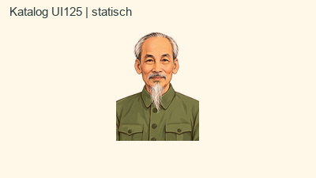

Neutrale cremefarbene Außenfläche; keine Szene. Geschützt: Gesicht, weiße Haar-/Bartsträhnen, Augen, olivfarbenes Hemd, Knöpfe und ursprünglicher Schulteranschnitt.

- Definition unverändert: `3bcde54a01d96e81529e41ac358157523f0aa113b84c1c9fdc15d43002d19523`
- Vorgängerbild: `4a192182d637c185d46f4128640200c68c663639e0e30a477363677c1e5eebe1`
- Neue Bilddatei: `1f5ba4ca6d8d366fa53bb98ada40d24466e90c5655b45a03c8f9a32f7f7fc8af`
- Zielnotice: `b38fe5940cde8a119abf831aee8e8c8bd25b0658d435a326da20a7bc06384f8d`

[Einzeldatei](../content/authoring/pz-023b50b44d1c4698a6e17e65b6ea4337/at-b-r01/reveal.png) · [Original](../content/authoring/pz-023b50b44d1c4698a6e17e65b6ea4337/at-b-r01/original.png) · [Vergleich und Bestandsraster](../content/authoring/pz-023b50b44d1c4698a6e17e65b6ea4337/at-b-r01/comparison.jpg) · [Kanten](../content/authoring/pz-023b50b44d1c4698a6e17e65b6ea4337/at-b-r01/edges.jpg) · [Großansicht](../content/authoring/pz-023b50b44d1c4698a6e17e65b6ea4337/at-b-r01/large-paper.jpg) · [Katalog UI100](../content/authoring/pz-023b50b44d1c4698a6e17e65b6ea4337/at-b-r01/catalog-ui100.jpg) · [Abschluss UI100](../content/authoring/pz-023b50b44d1c4698a6e17e65b6ea4337/at-b-r01/completion-ui100.jpg) · [Abschluss UI125](../content/authoring/pz-023b50b44d1c4698a6e17e65b6ea4337/at-b-r01/completion-ui125.jpg).

[Freigabevorlage](../content/authoring/pz-023b50b44d1c4698a6e17e65b6ea4337/at-b-r01/approval-proposal.json) · [vollständige Zielnotice](../content/authoring/pz-023b50b44d1c4698a6e17e65b6ea4337/at-b-r01/target-notice.txt) · [Einzelbericht und Grenzen](../content/authoring/pz-023b50b44d1c4698a6e17e65b6ea4337/at-b-r01/report.md) · [ZIP](../content/authoring/pz-023b50b44d1c4698a6e17e65b6ea4337/at-b-r01/package.zip) · [Record mit Paket-/Handoff-/Inventarhash](../content/authoring/pz-023b50b44d1c4698a6e17e65b6ea4337/at-b-r01/record.json).

### 02 · Windspiel

ID `pz-20219e14dbe242689b9ef06297828f34` · vorgeschlagene AT-Bildrevision **1** · Paket `at-b-r01`.

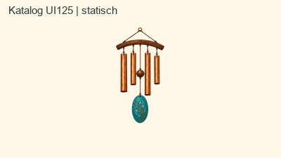

Neutrale Außenfläche und echte Lücken in Ring, Seilen und Röhren. Geschützt: Vier Kupferröhren, fünf Hängeschnüre, Holzträger, Klöppel, Perlen und türkisfarbenes Windsegel; dunkle Röhreninnenräume bleiben Material.

- Definition unverändert: `c590aa9ba963a98f2c53819c9313925e4a3b54bcb7360ea41b86d39037351155`
- Vorgängerbild: `82a90396033ea58038de07396a5d741e8edea745f711f91a07232ab912e2c278`
- Neue Bilddatei: `7eb95ed3144950bb3e9235cee17736fef6ed6a8505abddf615cccfb253e44a72`
- Zielnotice: `e19ca36c8ca41e06de224655dd72e64ee11e87ec4bf33da47956ab4871d13145`

[Einzeldatei](../content/authoring/pz-20219e14dbe242689b9ef06297828f34/at-b-r01/reveal.png) · [Original](../content/authoring/pz-20219e14dbe242689b9ef06297828f34/at-b-r01/original.png) · [Vergleich und Bestandsraster](../content/authoring/pz-20219e14dbe242689b9ef06297828f34/at-b-r01/comparison.jpg) · [Kanten](../content/authoring/pz-20219e14dbe242689b9ef06297828f34/at-b-r01/edges.jpg) · [Großansicht](../content/authoring/pz-20219e14dbe242689b9ef06297828f34/at-b-r01/large-paper.jpg) · [Katalog UI100](../content/authoring/pz-20219e14dbe242689b9ef06297828f34/at-b-r01/catalog-ui100.jpg) · [Abschluss UI100](../content/authoring/pz-20219e14dbe242689b9ef06297828f34/at-b-r01/completion-ui100.jpg) · [Abschluss UI125](../content/authoring/pz-20219e14dbe242689b9ef06297828f34/at-b-r01/completion-ui125.jpg).

[Freigabevorlage](../content/authoring/pz-20219e14dbe242689b9ef06297828f34/at-b-r01/approval-proposal.json) · [vollständige Zielnotice](../content/authoring/pz-20219e14dbe242689b9ef06297828f34/at-b-r01/target-notice.txt) · [Einzelbericht und Grenzen](../content/authoring/pz-20219e14dbe242689b9ef06297828f34/at-b-r01/report.md) · [ZIP](../content/authoring/pz-20219e14dbe242689b9ef06297828f34/at-b-r01/package.zip) · [Record mit Paket-/Handoff-/Inventarhash](../content/authoring/pz-20219e14dbe242689b9ef06297828f34/at-b-r01/record.json).

### 03 · Kolibri

ID `pz-25d245061b0c49c190788de8e5d0e45b` · vorgeschlagene AT-Bildrevision **1** · Paket `at-b-r01`.

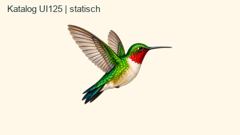

Neutrale Außenfläche um fliegenden Vogel. Geschützt: Langer Schnabel, sämtliche Federkeile, weiße Brust, rote Kehle, grüner Körper und Schwanz.

- Definition unverändert: `6c3525419f9ca193efd72bab11b9d6ca85fc7ba09507c65388d21921db291592`
- Vorgängerbild: `9b4fa04b16efebcd19d350e347d54537f992ea4e340766623aec05d5abe09dbe`
- Neue Bilddatei: `0afea62b0d1580edf84654ed327988383ab7ac4c872ae5f425e92f6a2907bb60`
- Zielnotice: `48d3820757b68eee96884b5efb3b095928b2faaa99cbaab8ba265139cbb53852`

[Einzeldatei](../content/authoring/pz-25d245061b0c49c190788de8e5d0e45b/at-b-r01/reveal.png) · [Original](../content/authoring/pz-25d245061b0c49c190788de8e5d0e45b/at-b-r01/original.png) · [Vergleich und Bestandsraster](../content/authoring/pz-25d245061b0c49c190788de8e5d0e45b/at-b-r01/comparison.jpg) · [Kanten](../content/authoring/pz-25d245061b0c49c190788de8e5d0e45b/at-b-r01/edges.jpg) · [Großansicht](../content/authoring/pz-25d245061b0c49c190788de8e5d0e45b/at-b-r01/large-paper.jpg) · [Katalog UI100](../content/authoring/pz-25d245061b0c49c190788de8e5d0e45b/at-b-r01/catalog-ui100.jpg) · [Abschluss UI100](../content/authoring/pz-25d245061b0c49c190788de8e5d0e45b/at-b-r01/completion-ui100.jpg) · [Abschluss UI125](../content/authoring/pz-25d245061b0c49c190788de8e5d0e45b/at-b-r01/completion-ui125.jpg).

[Freigabevorlage](../content/authoring/pz-25d245061b0c49c190788de8e5d0e45b/at-b-r01/approval-proposal.json) · [vollständige Zielnotice](../content/authoring/pz-25d245061b0c49c190788de8e5d0e45b/at-b-r01/target-notice.txt) · [Einzelbericht und Grenzen](../content/authoring/pz-25d245061b0c49c190788de8e5d0e45b/at-b-r01/report.md) · [ZIP](../content/authoring/pz-25d245061b0c49c190788de8e5d0e45b/at-b-r01/package.zip) · [Record mit Paket-/Handoff-/Inventarhash](../content/authoring/pz-25d245061b0c49c190788de8e5d0e45b/at-b-r01/record.json).

### 04 · Brandenburger Tor

ID `pz-2a8481f61e6443bda174bd3da67c` · vorgeschlagene AT-Bildrevision **1** · Paket `at-b-r01`.

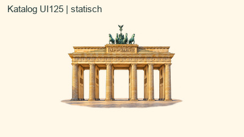

Neutraler Himmel und echte Durchgänge; Pflaster als schmal auslaufende Standfläche behalten. Geschützt: Sechs Säulen, Perspektive der Durchgänge, Reliefs und Quadriga einschließlich feiner Zügel; echte Wandflächen nicht aushöhlen.

- Definition unverändert: `9021e828087d070457210b75dccdbf35fb01f2dde4be739eee3dd433ff29f831`
- Vorgängerbild: `b2d10a0490dbce384ab9fd5df94c523b901c3d79731931fbebe60d790be2519a`
- Neue Bilddatei: `496479ab0cd2b214560f5f9f18ea6067ac21b91aab76af48874282aacd63af48`
- Zielnotice: `9635cf0e0aacf673bfeafc169abfcfa2e8599a44c4339db05e8e0ab4053bf6fc`

[Einzeldatei](../content/authoring/pz-2a8481f61e6443bda174bd3da67c/at-b-r01/reveal.png) · [Original](../content/authoring/pz-2a8481f61e6443bda174bd3da67c/at-b-r01/original.png) · [Vergleich und Bestandsraster](../content/authoring/pz-2a8481f61e6443bda174bd3da67c/at-b-r01/comparison.jpg) · [Kanten](../content/authoring/pz-2a8481f61e6443bda174bd3da67c/at-b-r01/edges.jpg) · [Großansicht](../content/authoring/pz-2a8481f61e6443bda174bd3da67c/at-b-r01/large-paper.jpg) · [Katalog UI100](../content/authoring/pz-2a8481f61e6443bda174bd3da67c/at-b-r01/catalog-ui100.jpg) · [Abschluss UI100](../content/authoring/pz-2a8481f61e6443bda174bd3da67c/at-b-r01/completion-ui100.jpg) · [Abschluss UI125](../content/authoring/pz-2a8481f61e6443bda174bd3da67c/at-b-r01/completion-ui125.jpg).

[Freigabevorlage](../content/authoring/pz-2a8481f61e6443bda174bd3da67c/at-b-r01/approval-proposal.json) · [vollständige Zielnotice](../content/authoring/pz-2a8481f61e6443bda174bd3da67c/at-b-r01/target-notice.txt) · [Einzelbericht und Grenzen](../content/authoring/pz-2a8481f61e6443bda174bd3da67c/at-b-r01/report.md) · [ZIP](../content/authoring/pz-2a8481f61e6443bda174bd3da67c/at-b-r01/package.zip) · [Record mit Paket-/Handoff-/Inventarhash](../content/authoring/pz-2a8481f61e6443bda174bd3da67c/at-b-r01/record.json).

### 05 · Knoblauch

ID `pz-3a744ae1b7cb4d38b0ac29d030ef` · vorgeschlagene AT-Bildrevision **1** · Paket `at-b-r01`.

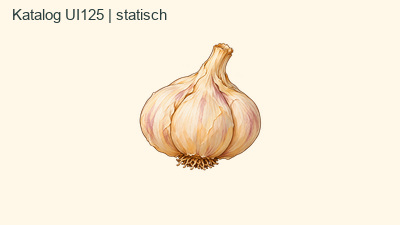

Apricotfarbene Außenfläche und Bodenschatten entfernen, echte Wurzellücken öffnen. Geschützt: Helle Schalen, rosa Akzente, Stiel, braune Konturen und feine Wurzeln.

- Definition unverändert: `c5d5685f0bf4810ea2208aad43170fd9484fbb9c1d198f03edba07a9f858a63a`
- Vorgängerbild: `0a102f0e49cd93f9b2851d9e5d7ba82edb601102055322a1628e806d544a4674`
- Neue Bilddatei: `0d6bf175396e5afae00269e667f8a0351513b5829aa6a8180526053b34c8ebdc`
- Zielnotice: `634ac440b54cb9453f18c20c23774a3f7dc563461591f5c334da5158c76cc217`

[Einzeldatei](../content/authoring/pz-3a744ae1b7cb4d38b0ac29d030ef/at-b-r01/reveal.png) · [Original](../content/authoring/pz-3a744ae1b7cb4d38b0ac29d030ef/at-b-r01/original.png) · [Vergleich und Bestandsraster](../content/authoring/pz-3a744ae1b7cb4d38b0ac29d030ef/at-b-r01/comparison.jpg) · [Kanten](../content/authoring/pz-3a744ae1b7cb4d38b0ac29d030ef/at-b-r01/edges.jpg) · [Großansicht](../content/authoring/pz-3a744ae1b7cb4d38b0ac29d030ef/at-b-r01/large-paper.jpg) · [Katalog UI100](../content/authoring/pz-3a744ae1b7cb4d38b0ac29d030ef/at-b-r01/catalog-ui100.jpg) · [Abschluss UI100](../content/authoring/pz-3a744ae1b7cb4d38b0ac29d030ef/at-b-r01/completion-ui100.jpg) · [Abschluss UI125](../content/authoring/pz-3a744ae1b7cb4d38b0ac29d030ef/at-b-r01/completion-ui125.jpg).

[Freigabevorlage](../content/authoring/pz-3a744ae1b7cb4d38b0ac29d030ef/at-b-r01/approval-proposal.json) · [vollständige Zielnotice](../content/authoring/pz-3a744ae1b7cb4d38b0ac29d030ef/at-b-r01/target-notice.txt) · [Einzelbericht und Grenzen](../content/authoring/pz-3a744ae1b7cb4d38b0ac29d030ef/at-b-r01/report.md) · [ZIP](../content/authoring/pz-3a744ae1b7cb4d38b0ac29d030ef/at-b-r01/package.zip) · [Record mit Paket-/Handoff-/Inventarhash](../content/authoring/pz-3a744ae1b7cb4d38b0ac29d030ef/at-b-r01/record.json).

### 06 · Yin-Yang

ID `pz-3e97c042f0bf474e8608a84ea034c246` · vorgeschlagene AT-Bildrevision **1** · Paket `at-b-r01`.

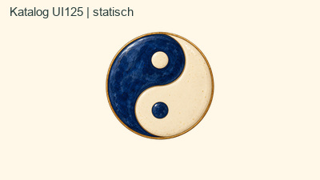

Nur Außenfläche außerhalb des Goldrandes; keine inneren Aussparungen. Geschützt: Elfenbeinfarbene Hälfte und heller Kreis bleiben Motiv, ebenso blaue Keramik, Marmorierung und Goldrand.

- Definition unverändert: `ac3c241cf208ae5f696a717bbd39cc3293f8396c4cb2bedc11efa8c17a6cf226`
- Vorgängerbild: `d07fc024a822789a8c454f46c85f633da671ff21a537c6c30a77a2a997c5f63e`
- Neue Bilddatei: `a3c192f26e416d4ce4fadf273239d181dda581cfc415bcd869ec1a65518b61fe`
- Zielnotice: `6f6ccc513b1f5ac9d3201b38e10c6592218cce272bb39be82e0d798becb0f678`

[Einzeldatei](../content/authoring/pz-3e97c042f0bf474e8608a84ea034c246/at-b-r01/reveal.png) · [Original](../content/authoring/pz-3e97c042f0bf474e8608a84ea034c246/at-b-r01/original.png) · [Vergleich und Bestandsraster](../content/authoring/pz-3e97c042f0bf474e8608a84ea034c246/at-b-r01/comparison.jpg) · [Kanten](../content/authoring/pz-3e97c042f0bf474e8608a84ea034c246/at-b-r01/edges.jpg) · [Großansicht](../content/authoring/pz-3e97c042f0bf474e8608a84ea034c246/at-b-r01/large-paper.jpg) · [Katalog UI100](../content/authoring/pz-3e97c042f0bf474e8608a84ea034c246/at-b-r01/catalog-ui100.jpg) · [Abschluss UI100](../content/authoring/pz-3e97c042f0bf474e8608a84ea034c246/at-b-r01/completion-ui100.jpg) · [Abschluss UI125](../content/authoring/pz-3e97c042f0bf474e8608a84ea034c246/at-b-r01/completion-ui125.jpg).

[Freigabevorlage](../content/authoring/pz-3e97c042f0bf474e8608a84ea034c246/at-b-r01/approval-proposal.json) · [vollständige Zielnotice](../content/authoring/pz-3e97c042f0bf474e8608a84ea034c246/at-b-r01/target-notice.txt) · [Einzelbericht und Grenzen](../content/authoring/pz-3e97c042f0bf474e8608a84ea034c246/at-b-r01/report.md) · [ZIP](../content/authoring/pz-3e97c042f0bf474e8608a84ea034c246/at-b-r01/package.zip) · [Record mit Paket-/Handoff-/Inventarhash](../content/authoring/pz-3e97c042f0bf474e8608a84ea034c246/at-b-r01/record.json).

### 07 · Japanische Teekanne

ID `pz-51405ea1ad194507a60c9b6701d802f0` · vorgeschlagene AT-Bildrevision **1** · Paket `at-b-r01`.

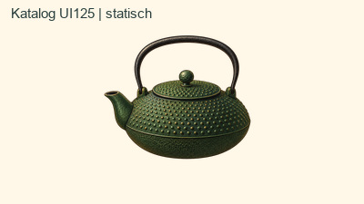

Außenfläche und großer Henkelinnenraum transparent. Geschützt: Gussstruktur, Goldreflexe, Deckelknauf, Griff und dunkle Ausgussöffnung als Material.

- Definition unverändert: `05b8abcdfcfb478ca19538e2b8132a91ce364ffb52fa5699605f8a00741b253a`
- Vorgängerbild: `7754db5a3214634db0eb41a4cbb5ed8496b2cce812fc0ec9ae2102d017a388f2`
- Neue Bilddatei: `53fe49d243f772215efe018bbd8c8d2376fa265c7be9f3b47452c08904e473b9`
- Zielnotice: `45da036f2b454ba66496c799302505575bff3a204e068ef0390cf64f149a4596`

[Einzeldatei](../content/authoring/pz-51405ea1ad194507a60c9b6701d802f0/at-b-r01/reveal.png) · [Original](../content/authoring/pz-51405ea1ad194507a60c9b6701d802f0/at-b-r01/original.png) · [Vergleich und Bestandsraster](../content/authoring/pz-51405ea1ad194507a60c9b6701d802f0/at-b-r01/comparison.jpg) · [Kanten](../content/authoring/pz-51405ea1ad194507a60c9b6701d802f0/at-b-r01/edges.jpg) · [Großansicht](../content/authoring/pz-51405ea1ad194507a60c9b6701d802f0/at-b-r01/large-paper.jpg) · [Katalog UI100](../content/authoring/pz-51405ea1ad194507a60c9b6701d802f0/at-b-r01/catalog-ui100.jpg) · [Abschluss UI100](../content/authoring/pz-51405ea1ad194507a60c9b6701d802f0/at-b-r01/completion-ui100.jpg) · [Abschluss UI125](../content/authoring/pz-51405ea1ad194507a60c9b6701d802f0/at-b-r01/completion-ui125.jpg).

[Freigabevorlage](../content/authoring/pz-51405ea1ad194507a60c9b6701d802f0/at-b-r01/approval-proposal.json) · [vollständige Zielnotice](../content/authoring/pz-51405ea1ad194507a60c9b6701d802f0/at-b-r01/target-notice.txt) · [Einzelbericht und Grenzen](../content/authoring/pz-51405ea1ad194507a60c9b6701d802f0/at-b-r01/report.md) · [ZIP](../content/authoring/pz-51405ea1ad194507a60c9b6701d802f0/at-b-r01/package.zip) · [Record mit Paket-/Handoff-/Inventarhash](../content/authoring/pz-51405ea1ad194507a60c9b6701d802f0/at-b-r01/record.json).

### 08 · Gecko

ID `pz-5ad1e06e19ab475baebc582d4999daa5` · vorgeschlagene AT-Bildrevision **1** · Paket `at-b-r01`.

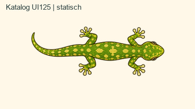

Außenfläche sowie Zwischenräume aller Zehen und Beine. Geschützt: Draufsicht, grün-gelbe Schuppen, Augen, vier Füße und Schwanzbogen.

- Definition unverändert: `aed678373d87e89a2b00b15c27b38ba6a8321a5960f1cf03c7a989e54c54ff14`
- Vorgängerbild: `f6a7aa1b67e2a336b39f6a79fa638dad7a3ae57487e6ae975e1d28fa239f632d`
- Neue Bilddatei: `df663428366ba6a0802d28934bf1a0ee4dfb76ae32c9200e89057a7434dfb45b`
- Zielnotice: `bcbfc2d9664d044fd39ecef9611aeae4ddd0f4fcc3bde55a741002d73a340a71`

[Einzeldatei](../content/authoring/pz-5ad1e06e19ab475baebc582d4999daa5/at-b-r01/reveal.png) · [Original](../content/authoring/pz-5ad1e06e19ab475baebc582d4999daa5/at-b-r01/original.png) · [Vergleich und Bestandsraster](../content/authoring/pz-5ad1e06e19ab475baebc582d4999daa5/at-b-r01/comparison.jpg) · [Kanten](../content/authoring/pz-5ad1e06e19ab475baebc582d4999daa5/at-b-r01/edges.jpg) · [Großansicht](../content/authoring/pz-5ad1e06e19ab475baebc582d4999daa5/at-b-r01/large-paper.jpg) · [Katalog UI100](../content/authoring/pz-5ad1e06e19ab475baebc582d4999daa5/at-b-r01/catalog-ui100.jpg) · [Abschluss UI100](../content/authoring/pz-5ad1e06e19ab475baebc582d4999daa5/at-b-r01/completion-ui100.jpg) · [Abschluss UI125](../content/authoring/pz-5ad1e06e19ab475baebc582d4999daa5/at-b-r01/completion-ui125.jpg).

[Freigabevorlage](../content/authoring/pz-5ad1e06e19ab475baebc582d4999daa5/at-b-r01/approval-proposal.json) · [vollständige Zielnotice](../content/authoring/pz-5ad1e06e19ab475baebc582d4999daa5/at-b-r01/target-notice.txt) · [Einzelbericht und Grenzen](../content/authoring/pz-5ad1e06e19ab475baebc582d4999daa5/at-b-r01/report.md) · [ZIP](../content/authoring/pz-5ad1e06e19ab475baebc582d4999daa5/at-b-r01/package.zip) · [Record mit Paket-/Handoff-/Inventarhash](../content/authoring/pz-5ad1e06e19ab475baebc582d4999daa5/at-b-r01/record.json).

### 09 · Pfirsich

ID `pz-72561c715dd741f9b0082c7ad24802c1` · vorgeschlagene AT-Bildrevision **1** · Paket `at-b-r01`.

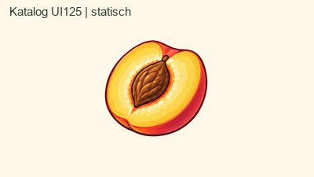

Cremefarbene Außenfläche und ovaler Bodenschatten. Geschützt: Rote Schale, gelbes Fruchtfleisch, brauner Stein und helle Fruchtreflexe; keine neue Motivfindung.

- Definition unverändert: `6f755f67359f46015b8bc2eee79849c87d2d46e3a041c91234b3fb09f4bfdd4b`
- Vorgängerbild: `02805fd71b357341b2bd354d5ce9761b55a36cce3e90b6f36a4fc66e1fc1b4ab`
- Neue Bilddatei: `3706d19818ea7a61cbfcb95402554113d247f1063a2e2ca83e0cf5fe0c2f3cbe`
- Zielnotice: `755a65b04b4851cd2bbcb650fd2be4fbdf24f0a12b72d940827de156961379d5`

[Einzeldatei](../content/authoring/pz-72561c715dd741f9b0082c7ad24802c1/at-b-r01/reveal.png) · [Original](../content/authoring/pz-72561c715dd741f9b0082c7ad24802c1/at-b-r01/original.png) · [Vergleich und Bestandsraster](../content/authoring/pz-72561c715dd741f9b0082c7ad24802c1/at-b-r01/comparison.jpg) · [Kanten](../content/authoring/pz-72561c715dd741f9b0082c7ad24802c1/at-b-r01/edges.jpg) · [Großansicht](../content/authoring/pz-72561c715dd741f9b0082c7ad24802c1/at-b-r01/large-paper.jpg) · [Katalog UI100](../content/authoring/pz-72561c715dd741f9b0082c7ad24802c1/at-b-r01/catalog-ui100.jpg) · [Abschluss UI100](../content/authoring/pz-72561c715dd741f9b0082c7ad24802c1/at-b-r01/completion-ui100.jpg) · [Abschluss UI125](../content/authoring/pz-72561c715dd741f9b0082c7ad24802c1/at-b-r01/completion-ui125.jpg).

[Freigabevorlage](../content/authoring/pz-72561c715dd741f9b0082c7ad24802c1/at-b-r01/approval-proposal.json) · [vollständige Zielnotice](../content/authoring/pz-72561c715dd741f9b0082c7ad24802c1/at-b-r01/target-notice.txt) · [Einzelbericht und Grenzen](../content/authoring/pz-72561c715dd741f9b0082c7ad24802c1/at-b-r01/report.md) · [ZIP](../content/authoring/pz-72561c715dd741f9b0082c7ad24802c1/at-b-r01/package.zip) · [Record mit Paket-/Handoff-/Inventarhash](../content/authoring/pz-72561c715dd741f9b0082c7ad24802c1/at-b-r01/record.json).

### 10 · Koboldmaki

ID `pz-72eb9b188896440c8a9a833e803835ec` · vorgeschlagene AT-Bildrevision **1** · Paket `at-b-r01`.

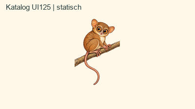

Außenfläche und Lücken zwischen Tier, Ast und Schwanz; Ast bleibt. Geschützt: Orange Augen, helle Gesichts-/Brustflächen, Fellsaum, Finger, Schwanzkurve und diagonale Astposition.

- Definition unverändert: `271b5a94009850972df72eaa81c0aefa26dbccd62c1389ea28413183c5159383`
- Vorgängerbild: `38ae36da53346a92ef6d9bccb1146ccf8a152593594405ce28d0a7d1d40322ea`
- Neue Bilddatei: `47712f05e7a2e3e0bbc7255f35af9d2407f52d50d0432ea4915be2370a9417ae`
- Zielnotice: `fa42d59651cdb8de1ee8d64898ffc64e2a8bd5836a35b8df005500f7618b28a1`

[Einzeldatei](../content/authoring/pz-72eb9b188896440c8a9a833e803835ec/at-b-r01/reveal.png) · [Original](../content/authoring/pz-72eb9b188896440c8a9a833e803835ec/at-b-r01/original.png) · [Vergleich und Bestandsraster](../content/authoring/pz-72eb9b188896440c8a9a833e803835ec/at-b-r01/comparison.jpg) · [Kanten](../content/authoring/pz-72eb9b188896440c8a9a833e803835ec/at-b-r01/edges.jpg) · [Großansicht](../content/authoring/pz-72eb9b188896440c8a9a833e803835ec/at-b-r01/large-paper.jpg) · [Katalog UI100](../content/authoring/pz-72eb9b188896440c8a9a833e803835ec/at-b-r01/catalog-ui100.jpg) · [Abschluss UI100](../content/authoring/pz-72eb9b188896440c8a9a833e803835ec/at-b-r01/completion-ui100.jpg) · [Abschluss UI125](../content/authoring/pz-72eb9b188896440c8a9a833e803835ec/at-b-r01/completion-ui125.jpg).

[Freigabevorlage](../content/authoring/pz-72eb9b188896440c8a9a833e803835ec/at-b-r01/approval-proposal.json) · [vollständige Zielnotice](../content/authoring/pz-72eb9b188896440c8a9a833e803835ec/at-b-r01/target-notice.txt) · [Einzelbericht und Grenzen](../content/authoring/pz-72eb9b188896440c8a9a833e803835ec/at-b-r01/report.md) · [ZIP](../content/authoring/pz-72eb9b188896440c8a9a833e803835ec/at-b-r01/package.zip) · [Record mit Paket-/Handoff-/Inventarhash](../content/authoring/pz-72eb9b188896440c8a9a833e803835ec/at-b-r01/record.json).

### 11 · Erbse

ID `pz-7ec3dcd94bf84e698691ef4b5839` · vorgeschlagene AT-Bildrevision **1** · Paket `at-b-r01`.

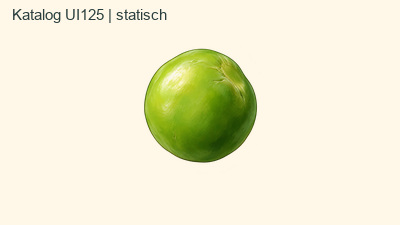

Neutrale Außenfläche und Bodenschatten. Geschützt: Einzelne grüne Erbse, Kerbe oben rechts, Rundung, Glanz und Schattierung.

- Definition unverändert: `f85c48639bfdff08bf36a087767c4fc6a67932da187ec708c1a61e184987f3c0`
- Vorgängerbild: `1fb67e28c130e50eeafd3aac92e575d83688d95e752e0cfe8361ceb8b15e29e8`
- Neue Bilddatei: `f0765f22be4b3fd740d8dc40df0962df7a1e9c23de6ea9069db8f68163b836d8`
- Zielnotice: `3c100bb0e5505277357d7edbbb8f5626d7351cf99722a3e9865c22078ae8c7cb`

[Einzeldatei](../content/authoring/pz-7ec3dcd94bf84e698691ef4b5839/at-b-r01/reveal.png) · [Original](../content/authoring/pz-7ec3dcd94bf84e698691ef4b5839/at-b-r01/original.png) · [Vergleich und Bestandsraster](../content/authoring/pz-7ec3dcd94bf84e698691ef4b5839/at-b-r01/comparison.jpg) · [Kanten](../content/authoring/pz-7ec3dcd94bf84e698691ef4b5839/at-b-r01/edges.jpg) · [Großansicht](../content/authoring/pz-7ec3dcd94bf84e698691ef4b5839/at-b-r01/large-paper.jpg) · [Katalog UI100](../content/authoring/pz-7ec3dcd94bf84e698691ef4b5839/at-b-r01/catalog-ui100.jpg) · [Abschluss UI100](../content/authoring/pz-7ec3dcd94bf84e698691ef4b5839/at-b-r01/completion-ui100.jpg) · [Abschluss UI125](../content/authoring/pz-7ec3dcd94bf84e698691ef4b5839/at-b-r01/completion-ui125.jpg).

[Freigabevorlage](../content/authoring/pz-7ec3dcd94bf84e698691ef4b5839/at-b-r01/approval-proposal.json) · [vollständige Zielnotice](../content/authoring/pz-7ec3dcd94bf84e698691ef4b5839/at-b-r01/target-notice.txt) · [Einzelbericht und Grenzen](../content/authoring/pz-7ec3dcd94bf84e698691ef4b5839/at-b-r01/report.md) · [ZIP](../content/authoring/pz-7ec3dcd94bf84e698691ef4b5839/at-b-r01/package.zip) · [Record mit Paket-/Handoff-/Inventarhash](../content/authoring/pz-7ec3dcd94bf84e698691ef4b5839/at-b-r01/record.json).

### 12 · Schachspringer

ID `pz-82758295d5d34284bbae2716f64f` · vorgeschlagene AT-Bildrevision **1** · Paket `at-b-r01`.

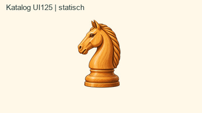

Außenfläche und Bodenschatten; Öffnung unter dem Maul. Geschützt: Beide Ohren, Profil, Auge, geschnitzte Mähne, Maserung und runder Sockel.

- Definition unverändert: `ed95c0b9ded61132a972402ad3aa04e3c7204549f2337c0fd7941273ac5ad1f2`
- Vorgängerbild: `cc126391c1835f9eba7721d09bee3a3a86abfc0582785ddd75ceef170605ff89`
- Neue Bilddatei: `869792beac0b2bf7d6f64ad73453b75bfdb90641105ac21d37d6fcebf21cb93c`
- Zielnotice: `5004aff052e1b4d401a6aef7685c46667eabe8ddd1a67b16a1348f2aae6c5131`

[Einzeldatei](../content/authoring/pz-82758295d5d34284bbae2716f64f/at-b-r01/reveal.png) · [Original](../content/authoring/pz-82758295d5d34284bbae2716f64f/at-b-r01/original.png) · [Vergleich und Bestandsraster](../content/authoring/pz-82758295d5d34284bbae2716f64f/at-b-r01/comparison.jpg) · [Kanten](../content/authoring/pz-82758295d5d34284bbae2716f64f/at-b-r01/edges.jpg) · [Großansicht](../content/authoring/pz-82758295d5d34284bbae2716f64f/at-b-r01/large-paper.jpg) · [Katalog UI100](../content/authoring/pz-82758295d5d34284bbae2716f64f/at-b-r01/catalog-ui100.jpg) · [Abschluss UI100](../content/authoring/pz-82758295d5d34284bbae2716f64f/at-b-r01/completion-ui100.jpg) · [Abschluss UI125](../content/authoring/pz-82758295d5d34284bbae2716f64f/at-b-r01/completion-ui125.jpg).

[Freigabevorlage](../content/authoring/pz-82758295d5d34284bbae2716f64f/at-b-r01/approval-proposal.json) · [vollständige Zielnotice](../content/authoring/pz-82758295d5d34284bbae2716f64f/at-b-r01/target-notice.txt) · [Einzelbericht und Grenzen](../content/authoring/pz-82758295d5d34284bbae2716f64f/at-b-r01/report.md) · [ZIP](../content/authoring/pz-82758295d5d34284bbae2716f64f/at-b-r01/package.zip) · [Record mit Paket-/Handoff-/Inventarhash](../content/authoring/pz-82758295d5d34284bbae2716f64f/at-b-r01/record.json).

### 13 · Efeutute

ID `pz-8ea7f3dacdcc428a9fcff7a735bc` · vorgeschlagene AT-Bildrevision **1** · Paket `at-b-r01`.

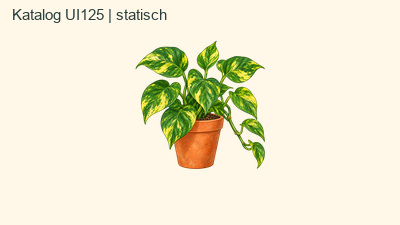

Außenfläche und echte Lücken zwischen Ranken und Blättern. Geschützt: Alle Blätter einschließlich gelber Panaschierung, dünne Triebe, Rankenbögen, Terrakottatopf und Erde.

- Definition unverändert: `b4bd247eeb6825c922a9d6d736e30e5ee043d9e04e7eef0531c064c04734a821`
- Vorgängerbild: `72ceb119b341b7ad8c96770a2042449f4f3d47ede648225e43062a3bae564472`
- Neue Bilddatei: `bed1a08639a5a3dc4308c5f804b8ff78174b1bf115c17347ba477b400257e313`
- Zielnotice: `1af11873c5deb9540ac73ec0904db636bdce257d9fa0a0e2f69201e65f01b5a1`

[Einzeldatei](../content/authoring/pz-8ea7f3dacdcc428a9fcff7a735bc/at-b-r01/reveal.png) · [Original](../content/authoring/pz-8ea7f3dacdcc428a9fcff7a735bc/at-b-r01/original.png) · [Vergleich und Bestandsraster](../content/authoring/pz-8ea7f3dacdcc428a9fcff7a735bc/at-b-r01/comparison.jpg) · [Kanten](../content/authoring/pz-8ea7f3dacdcc428a9fcff7a735bc/at-b-r01/edges.jpg) · [Großansicht](../content/authoring/pz-8ea7f3dacdcc428a9fcff7a735bc/at-b-r01/large-paper.jpg) · [Katalog UI100](../content/authoring/pz-8ea7f3dacdcc428a9fcff7a735bc/at-b-r01/catalog-ui100.jpg) · [Abschluss UI100](../content/authoring/pz-8ea7f3dacdcc428a9fcff7a735bc/at-b-r01/completion-ui100.jpg) · [Abschluss UI125](../content/authoring/pz-8ea7f3dacdcc428a9fcff7a735bc/at-b-r01/completion-ui125.jpg).

[Freigabevorlage](../content/authoring/pz-8ea7f3dacdcc428a9fcff7a735bc/at-b-r01/approval-proposal.json) · [vollständige Zielnotice](../content/authoring/pz-8ea7f3dacdcc428a9fcff7a735bc/at-b-r01/target-notice.txt) · [Einzelbericht und Grenzen](../content/authoring/pz-8ea7f3dacdcc428a9fcff7a735bc/at-b-r01/report.md) · [ZIP](../content/authoring/pz-8ea7f3dacdcc428a9fcff7a735bc/at-b-r01/package.zip) · [Record mit Paket-/Handoff-/Inventarhash](../content/authoring/pz-8ea7f3dacdcc428a9fcff7a735bc/at-b-r01/record.json).

### 14 · Warnemünde

ID `pz-8ecddf77e80c4543bf4ec714fe3d` · vorgeschlagene AT-Bildrevision **1** · Paket `at-b-r01`.

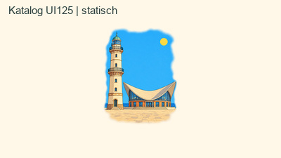

Zusammenhängende Szene mit transparenter unregelmäßiger Außenrandvignette; Himmel, Meer und Platz im Inneren bleiben. Geschützt: Leuchtturm, Teepott, Sonne, Geländer, Meereshorizont und räumliche Beziehungen; keine Verlagerung oder neue Architektur.

- Definition unverändert: `885e498fdc6c9674b584b8c8cd1e35b7dc92a8ef1335e152bbff08f847b32937`
- Vorgängerbild: `828ff4dec57c1269445bfdf0af4627d3acafbaa63155014cf68cfb5f89997f74`
- Neue Bilddatei: `c8300e88d06a79457dbfcb40460521c7fd2cf4b9d2a8c1a2d2de6bfffde8231e`
- Zielnotice: `40814a994edc1403c266b73b50dd15330a54e34559195a82aa713af4fc6bf8cf`

[Einzeldatei](../content/authoring/pz-8ecddf77e80c4543bf4ec714fe3d/at-b-r01/reveal.png) · [Original](../content/authoring/pz-8ecddf77e80c4543bf4ec714fe3d/at-b-r01/original.png) · [Vergleich und Bestandsraster](../content/authoring/pz-8ecddf77e80c4543bf4ec714fe3d/at-b-r01/comparison.jpg) · [Kanten](../content/authoring/pz-8ecddf77e80c4543bf4ec714fe3d/at-b-r01/edges.jpg) · [Großansicht](../content/authoring/pz-8ecddf77e80c4543bf4ec714fe3d/at-b-r01/large-paper.jpg) · [Katalog UI100](../content/authoring/pz-8ecddf77e80c4543bf4ec714fe3d/at-b-r01/catalog-ui100.jpg) · [Abschluss UI100](../content/authoring/pz-8ecddf77e80c4543bf4ec714fe3d/at-b-r01/completion-ui100.jpg) · [Abschluss UI125](../content/authoring/pz-8ecddf77e80c4543bf4ec714fe3d/at-b-r01/completion-ui125.jpg).

[Freigabevorlage](../content/authoring/pz-8ecddf77e80c4543bf4ec714fe3d/at-b-r01/approval-proposal.json) · [vollständige Zielnotice](../content/authoring/pz-8ecddf77e80c4543bf4ec714fe3d/at-b-r01/target-notice.txt) · [Einzelbericht und Grenzen](../content/authoring/pz-8ecddf77e80c4543bf4ec714fe3d/at-b-r01/report.md) · [ZIP](../content/authoring/pz-8ecddf77e80c4543bf4ec714fe3d/at-b-r01/package.zip) · [Record mit Paket-/Handoff-/Inventarhash](../content/authoring/pz-8ecddf77e80c4543bf4ec714fe3d/at-b-r01/record.json).

### 15 · Ingwer

ID `pz-985d36c1634644fbb2c8a0bf7de3aa9f` · vorgeschlagene AT-Bildrevision **1** · Paket `at-b-r01`.

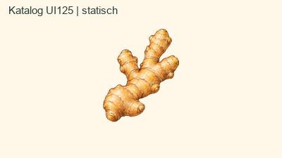

Neutrale Außenfläche zwischen den Verzweigungen und außen. Geschützt: Diagonale Form, sämtliche Knollen, helle Schale, Ringe, Schnittnarben und Konturen.

- Definition unverändert: `14dbbf1dc064d9674a96b964100267213bca3535ecf6e1bef9d083ce8ac6200f`
- Vorgängerbild: `f67bb2fc2e200fb68acfb0c0324520249b532419047cd645c94ce326018a3471`
- Neue Bilddatei: `286186c60a9390c60cb829b119ea9fbf32abe5462bb7c58ac9a2e3872523431f`
- Zielnotice: `08511a49a16946d8403416d659cace21ef8375b8ce656be8fb988b4e9aa51f57`

[Einzeldatei](../content/authoring/pz-985d36c1634644fbb2c8a0bf7de3aa9f/at-b-r01/reveal.png) · [Original](../content/authoring/pz-985d36c1634644fbb2c8a0bf7de3aa9f/at-b-r01/original.png) · [Vergleich und Bestandsraster](../content/authoring/pz-985d36c1634644fbb2c8a0bf7de3aa9f/at-b-r01/comparison.jpg) · [Kanten](../content/authoring/pz-985d36c1634644fbb2c8a0bf7de3aa9f/at-b-r01/edges.jpg) · [Großansicht](../content/authoring/pz-985d36c1634644fbb2c8a0bf7de3aa9f/at-b-r01/large-paper.jpg) · [Katalog UI100](../content/authoring/pz-985d36c1634644fbb2c8a0bf7de3aa9f/at-b-r01/catalog-ui100.jpg) · [Abschluss UI100](../content/authoring/pz-985d36c1634644fbb2c8a0bf7de3aa9f/at-b-r01/completion-ui100.jpg) · [Abschluss UI125](../content/authoring/pz-985d36c1634644fbb2c8a0bf7de3aa9f/at-b-r01/completion-ui125.jpg).

[Freigabevorlage](../content/authoring/pz-985d36c1634644fbb2c8a0bf7de3aa9f/at-b-r01/approval-proposal.json) · [vollständige Zielnotice](../content/authoring/pz-985d36c1634644fbb2c8a0bf7de3aa9f/at-b-r01/target-notice.txt) · [Einzelbericht und Grenzen](../content/authoring/pz-985d36c1634644fbb2c8a0bf7de3aa9f/at-b-r01/report.md) · [ZIP](../content/authoring/pz-985d36c1634644fbb2c8a0bf7de3aa9f/at-b-r01/package.zip) · [Record mit Paket-/Handoff-/Inventarhash](../content/authoring/pz-985d36c1634644fbb2c8a0bf7de3aa9f/at-b-r01/record.json).

### 16 · Buntspecht

ID `pz-9a79befc7a834e2d9d5896a477328962` · vorgeschlagene AT-Bildrevision **1** · Paket `at-b-r01`.

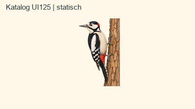

Außenfläche und echte Lücken zwischen Tier und Baum; Stamm vollständig behalten. Geschützt: Weißes Gefieder, Schnabel, schwarze und rote Zeichnung, beide Krallen, langer Schwanz, Rinde und ursprünglicher Stammanschnitt.

- Definition unverändert: `1f222523cd4bdff6bfc5440922f61788b529a25a28f90689b6c9c64f3012fef3`
- Vorgängerbild: `a6fba345c136c8f55abeea23f31fb7f7b7cacd5588a16de3b9c74db10cf83d6c`
- Neue Bilddatei: `611cf52c2f087f8e1d18c7e79b23c4508a9e54e63d2669348750f0b22405caf8`
- Zielnotice: `1ce26fdc485edb609176de79440b4840dc5217d27fc915530e0faa0362bb754b`

[Einzeldatei](../content/authoring/pz-9a79befc7a834e2d9d5896a477328962/at-b-r01/reveal.png) · [Original](../content/authoring/pz-9a79befc7a834e2d9d5896a477328962/at-b-r01/original.png) · [Vergleich und Bestandsraster](../content/authoring/pz-9a79befc7a834e2d9d5896a477328962/at-b-r01/comparison.jpg) · [Kanten](../content/authoring/pz-9a79befc7a834e2d9d5896a477328962/at-b-r01/edges.jpg) · [Großansicht](../content/authoring/pz-9a79befc7a834e2d9d5896a477328962/at-b-r01/large-paper.jpg) · [Katalog UI100](../content/authoring/pz-9a79befc7a834e2d9d5896a477328962/at-b-r01/catalog-ui100.jpg) · [Abschluss UI100](../content/authoring/pz-9a79befc7a834e2d9d5896a477328962/at-b-r01/completion-ui100.jpg) · [Abschluss UI125](../content/authoring/pz-9a79befc7a834e2d9d5896a477328962/at-b-r01/completion-ui125.jpg).

[Freigabevorlage](../content/authoring/pz-9a79befc7a834e2d9d5896a477328962/at-b-r01/approval-proposal.json) · [vollständige Zielnotice](../content/authoring/pz-9a79befc7a834e2d9d5896a477328962/at-b-r01/target-notice.txt) · [Einzelbericht und Grenzen](../content/authoring/pz-9a79befc7a834e2d9d5896a477328962/at-b-r01/report.md) · [ZIP](../content/authoring/pz-9a79befc7a834e2d9d5896a477328962/at-b-r01/package.zip) · [Record mit Paket-/Handoff-/Inventarhash](../content/authoring/pz-9a79befc7a834e2d9d5896a477328962/at-b-r01/record.json).

### 17 · Kaktus

ID `pz-a358a1bf1b994efcbebeb55abf825789` · vorgeschlagene AT-Bildrevision **1** · Paket `at-b-r01`.

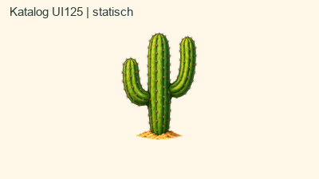

Neutrale Außenfläche; vorhandener Sand-/Steinhügel bleibt. Geschützt: Drei Arme, grüne Rippen, alle feinen Dornen und kleine Bodeninsel.

- Definition unverändert: `705a3cee777b1ab7a00e41b7d7fee5118906c1916bc4f3d55c97a1401e110938`
- Vorgängerbild: `0738b9ebabcbe20c3403f0654440ff08e1aed1a1caf626719613378d326d93f1`
- Neue Bilddatei: `21a88817c31f01fd2b62d2001faa07abeefb291737e72050937449b4f0bad139`
- Zielnotice: `87b4bce89ba47e705206dec06d594b6d0cb8649fa1594a2b2a76cf83a5090922`

[Einzeldatei](../content/authoring/pz-a358a1bf1b994efcbebeb55abf825789/at-b-r01/reveal.png) · [Original](../content/authoring/pz-a358a1bf1b994efcbebeb55abf825789/at-b-r01/original.png) · [Vergleich und Bestandsraster](../content/authoring/pz-a358a1bf1b994efcbebeb55abf825789/at-b-r01/comparison.jpg) · [Kanten](../content/authoring/pz-a358a1bf1b994efcbebeb55abf825789/at-b-r01/edges.jpg) · [Großansicht](../content/authoring/pz-a358a1bf1b994efcbebeb55abf825789/at-b-r01/large-paper.jpg) · [Katalog UI100](../content/authoring/pz-a358a1bf1b994efcbebeb55abf825789/at-b-r01/catalog-ui100.jpg) · [Abschluss UI100](../content/authoring/pz-a358a1bf1b994efcbebeb55abf825789/at-b-r01/completion-ui100.jpg) · [Abschluss UI125](../content/authoring/pz-a358a1bf1b994efcbebeb55abf825789/at-b-r01/completion-ui125.jpg).

[Freigabevorlage](../content/authoring/pz-a358a1bf1b994efcbebeb55abf825789/at-b-r01/approval-proposal.json) · [vollständige Zielnotice](../content/authoring/pz-a358a1bf1b994efcbebeb55abf825789/at-b-r01/target-notice.txt) · [Einzelbericht und Grenzen](../content/authoring/pz-a358a1bf1b994efcbebeb55abf825789/at-b-r01/report.md) · [ZIP](../content/authoring/pz-a358a1bf1b994efcbebeb55abf825789/at-b-r01/package.zip) · [Record mit Paket-/Handoff-/Inventarhash](../content/authoring/pz-a358a1bf1b994efcbebeb55abf825789/at-b-r01/record.json).

### 18 · Glas Bier mit Schaumkrone

ID `pz-ad7164c2302a42e5953f6779a1c7` · vorgeschlagene AT-Bildrevision **1** · Paket `at-b-r01`.

Außenfläche und echte Henkelöffnung freistellen. Geschützt: Weiße Schaumkrone, Tropfen, Glasreflexe, goldgelbes Bier, Blasen, Henkel und Boden; keine Transparenz durch Schaum/Reflexe.

- Definition unverändert: `d7c7bb015690d099f321528469d85487bc72ea963e186838717bafc8ffe859a0`
- Vorgängerbild: `54d053af4c1022dade010581b5b70823f4acc9a406057221ef638fc9f1a1c804`
- Neue Bilddatei: `d0f0bc903adee507fedb5dbbfcf1d9dba5475395661c52cde78aef77a982b609`
- Zielnotice: `171e9f4bcbc88bd2e07666b1059dd4b561d104b10a481172c129371109ab5f81`

[Einzeldatei](../content/authoring/pz-ad7164c2302a42e5953f6779a1c7/at-b-r01/reveal.png) · [Original](../content/authoring/pz-ad7164c2302a42e5953f6779a1c7/at-b-r01/original.png) · [Vergleich und Bestandsraster](../content/authoring/pz-ad7164c2302a42e5953f6779a1c7/at-b-r01/comparison.jpg) · [Kanten](../content/authoring/pz-ad7164c2302a42e5953f6779a1c7/at-b-r01/edges.jpg) · [Großansicht](../content/authoring/pz-ad7164c2302a42e5953f6779a1c7/at-b-r01/large-paper.jpg) · [Katalog UI100](../content/authoring/pz-ad7164c2302a42e5953f6779a1c7/at-b-r01/catalog-ui100.jpg) · [Abschluss UI100](../content/authoring/pz-ad7164c2302a42e5953f6779a1c7/at-b-r01/completion-ui100.jpg) · [Abschluss UI125](../content/authoring/pz-ad7164c2302a42e5953f6779a1c7/at-b-r01/completion-ui125.jpg).

[Freigabevorlage](../content/authoring/pz-ad7164c2302a42e5953f6779a1c7/at-b-r01/approval-proposal.json) · [vollständige Zielnotice](../content/authoring/pz-ad7164c2302a42e5953f6779a1c7/at-b-r01/target-notice.txt) · [Einzelbericht und Grenzen](../content/authoring/pz-ad7164c2302a42e5953f6779a1c7/at-b-r01/report.md) · [ZIP](../content/authoring/pz-ad7164c2302a42e5953f6779a1c7/at-b-r01/package.zip) · [Record mit Paket-/Handoff-/Inventarhash](../content/authoring/pz-ad7164c2302a42e5953f6779a1c7/at-b-r01/record.json).

### 19 · Hamburger

ID `pz-b3368aea28ac4a11bf09e0dc9c48` · vorgeschlagene AT-Bildrevision **1** · Paket `at-b-r01`.

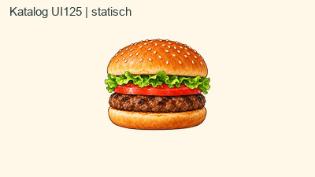

Neutrale Außenfläche und echte Außenlücken an Salatfalten. Geschützt: Sesam, beide Brötchenhälften, Salat, Tomate und Fleisch samt Farbe, Reihenfolge und Glanz.

- Definition unverändert: `5ce8a8f5dd6c7bb286120a79dc4cf6ff543e31530b058d0802cd0dd52ab48f23`
- Vorgängerbild: `aa87a8a391b2183d5d479efbb165f46e36ad6e3a73e2eaa0267c191379903074`
- Neue Bilddatei: `5260b0701ae62bb130cdd09c876ec5b5a83d956c65cc9e5546fb393251939517`
- Zielnotice: `f4139f038dd14791a397e0e6a6cdcce416ab712beb844b3c0e6a3ff5dc487c42`

[Einzeldatei](../content/authoring/pz-b3368aea28ac4a11bf09e0dc9c48/at-b-r01/reveal.png) · [Original](../content/authoring/pz-b3368aea28ac4a11bf09e0dc9c48/at-b-r01/original.png) · [Vergleich und Bestandsraster](../content/authoring/pz-b3368aea28ac4a11bf09e0dc9c48/at-b-r01/comparison.jpg) · [Kanten](../content/authoring/pz-b3368aea28ac4a11bf09e0dc9c48/at-b-r01/edges.jpg) · [Großansicht](../content/authoring/pz-b3368aea28ac4a11bf09e0dc9c48/at-b-r01/large-paper.jpg) · [Katalog UI100](../content/authoring/pz-b3368aea28ac4a11bf09e0dc9c48/at-b-r01/catalog-ui100.jpg) · [Abschluss UI100](../content/authoring/pz-b3368aea28ac4a11bf09e0dc9c48/at-b-r01/completion-ui100.jpg) · [Abschluss UI125](../content/authoring/pz-b3368aea28ac4a11bf09e0dc9c48/at-b-r01/completion-ui125.jpg).

[Freigabevorlage](../content/authoring/pz-b3368aea28ac4a11bf09e0dc9c48/at-b-r01/approval-proposal.json) · [vollständige Zielnotice](../content/authoring/pz-b3368aea28ac4a11bf09e0dc9c48/at-b-r01/target-notice.txt) · [Einzelbericht und Grenzen](../content/authoring/pz-b3368aea28ac4a11bf09e0dc9c48/at-b-r01/report.md) · [ZIP](../content/authoring/pz-b3368aea28ac4a11bf09e0dc9c48/at-b-r01/package.zip) · [Record mit Paket-/Handoff-/Inventarhash](../content/authoring/pz-b3368aea28ac4a11bf09e0dc9c48/at-b-r01/record.json).

### 20 · Carabao – Kopf

ID `pz-b5e2302bf71445c09caac76bbc2a7075` · vorgeschlagene AT-Bildrevision **1** · Paket `at-b-r01`.

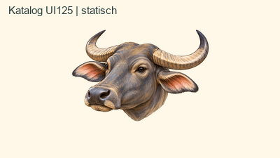

Neutrale Außenfläche und freie Bereiche zwischen Hörnern. Geschützt: Aktueller Kopf aus r11, keine ältere Ganzkörperfassung; Hornbögen, Ohren, Augen, Maul und feine Haare.

- Definition unverändert: `61c4a6d8e76237dbf5dafa7ec24693fe96a8ddc8680b5dc51b8513d4feeb53ff`
- Vorgängerbild: `b382978fca16415070b83cf41e5a684ee26ac81e87a94ab4824d0f06b89db280`
- Neue Bilddatei: `9754af1c084e389f84b06690d6b6a286846fd1e7149e1a62b8ade7146c5c3a39`
- Zielnotice: `6335e00106a583ccc9b29d127b95da1487875cf0823db7795c941c5a7cdaa1e8`

[Einzeldatei](../content/authoring/pz-b5e2302bf71445c09caac76bbc2a7075/at-b-r01/reveal.png) · [Original](../content/authoring/pz-b5e2302bf71445c09caac76bbc2a7075/at-b-r01/original.png) · [Vergleich und Bestandsraster](../content/authoring/pz-b5e2302bf71445c09caac76bbc2a7075/at-b-r01/comparison.jpg) · [Kanten](../content/authoring/pz-b5e2302bf71445c09caac76bbc2a7075/at-b-r01/edges.jpg) · [Großansicht](../content/authoring/pz-b5e2302bf71445c09caac76bbc2a7075/at-b-r01/large-paper.jpg) · [Katalog UI100](../content/authoring/pz-b5e2302bf71445c09caac76bbc2a7075/at-b-r01/catalog-ui100.jpg) · [Abschluss UI100](../content/authoring/pz-b5e2302bf71445c09caac76bbc2a7075/at-b-r01/completion-ui100.jpg) · [Abschluss UI125](../content/authoring/pz-b5e2302bf71445c09caac76bbc2a7075/at-b-r01/completion-ui125.jpg).

[Freigabevorlage](../content/authoring/pz-b5e2302bf71445c09caac76bbc2a7075/at-b-r01/approval-proposal.json) · [vollständige Zielnotice](../content/authoring/pz-b5e2302bf71445c09caac76bbc2a7075/at-b-r01/target-notice.txt) · [Einzelbericht und Grenzen](../content/authoring/pz-b5e2302bf71445c09caac76bbc2a7075/at-b-r01/report.md) · [ZIP](../content/authoring/pz-b5e2302bf71445c09caac76bbc2a7075/at-b-r01/package.zip) · [Record mit Paket-/Handoff-/Inventarhash](../content/authoring/pz-b5e2302bf71445c09caac76bbc2a7075/at-b-r01/record.json).

### 21 · Stirnlappenbasilisk

ID `pz-c71563f1b8c940de998afdd62f09` · vorgeschlagene AT-Bildrevision **1** · Paket `at-b-r01`.

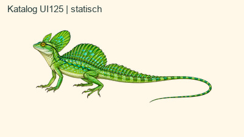

Außenfläche und Bodenschatten, Lücken zwischen Zehen, Beinen und Schwanz. Geschützt: Kopfhaube, Rücken-/Schwanzsegel, blaue Schuppenpunkte, heller Bauch, Krallen und gesamte Schwanzspitze.

- Definition unverändert: `0c13e049c23fbc0a58b3251a5644950045101fc3d3bcf36b4d2e0cc8194190e6`
- Vorgängerbild: `9da4019b8755311b24338dcfdd76cf7e9d31e57081cd009cccc05a7c48c7ea2c`
- Neue Bilddatei: `1a66386a87d6303dbc68131170333d847496e18b48e6ba236f4577d2ddcebb24`
- Zielnotice: `cb456ab8e51823839afa87542fef502a1b8cd47dcd96fe1b3aa13d9687b27d22`

[Einzeldatei](../content/authoring/pz-c71563f1b8c940de998afdd62f09/at-b-r01/reveal.png) · [Original](../content/authoring/pz-c71563f1b8c940de998afdd62f09/at-b-r01/original.png) · [Vergleich und Bestandsraster](../content/authoring/pz-c71563f1b8c940de998afdd62f09/at-b-r01/comparison.jpg) · [Kanten](../content/authoring/pz-c71563f1b8c940de998afdd62f09/at-b-r01/edges.jpg) · [Großansicht](../content/authoring/pz-c71563f1b8c940de998afdd62f09/at-b-r01/large-paper.jpg) · [Katalog UI100](../content/authoring/pz-c71563f1b8c940de998afdd62f09/at-b-r01/catalog-ui100.jpg) · [Abschluss UI100](../content/authoring/pz-c71563f1b8c940de998afdd62f09/at-b-r01/completion-ui100.jpg) · [Abschluss UI125](../content/authoring/pz-c71563f1b8c940de998afdd62f09/at-b-r01/completion-ui125.jpg).

[Freigabevorlage](../content/authoring/pz-c71563f1b8c940de998afdd62f09/at-b-r01/approval-proposal.json) · [vollständige Zielnotice](../content/authoring/pz-c71563f1b8c940de998afdd62f09/at-b-r01/target-notice.txt) · [Einzelbericht und Grenzen](../content/authoring/pz-c71563f1b8c940de998afdd62f09/at-b-r01/report.md) · [ZIP](../content/authoring/pz-c71563f1b8c940de998afdd62f09/at-b-r01/package.zip) · [Record mit Paket-/Handoff-/Inventarhash](../content/authoring/pz-c71563f1b8c940de998afdd62f09/at-b-r01/record.json).

### 22 · Rote Nelke

ID `pz-d7e68d1138a3448c8b2a4b07e8632350` · vorgeschlagene AT-Bildrevision **1** · Paket `at-b-r01`.

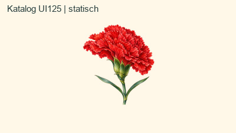

Neutrale Außenfläche und Blattzwischenräume. Geschützt: Gezähnte rote Blütenränder, helle Blütenreflexe, grüner Kelch, beide schmalen Blätter und Stiel.

- Definition unverändert: `f54a0ec597198a25a77677d0cde321bea69ad1ecaff934ad0b9236edd82b2556`
- Vorgängerbild: `b2aca07f471a9f49daac505166e2179e4589942ac3850b44345b80f9989e3ffe`
- Neue Bilddatei: `c30cc030c4b4621ccedb3a5fff9b00be1fc07a54f03b35cf3d4de0e494a29232`
- Zielnotice: `1595a66efeef23e016740f5b2682f11ff15bd86a6f51718a113aaec7a719303d`

[Einzeldatei](../content/authoring/pz-d7e68d1138a3448c8b2a4b07e8632350/at-b-r01/reveal.png) · [Original](../content/authoring/pz-d7e68d1138a3448c8b2a4b07e8632350/at-b-r01/original.png) · [Vergleich und Bestandsraster](../content/authoring/pz-d7e68d1138a3448c8b2a4b07e8632350/at-b-r01/comparison.jpg) · [Kanten](../content/authoring/pz-d7e68d1138a3448c8b2a4b07e8632350/at-b-r01/edges.jpg) · [Großansicht](../content/authoring/pz-d7e68d1138a3448c8b2a4b07e8632350/at-b-r01/large-paper.jpg) · [Katalog UI100](../content/authoring/pz-d7e68d1138a3448c8b2a4b07e8632350/at-b-r01/catalog-ui100.jpg) · [Abschluss UI100](../content/authoring/pz-d7e68d1138a3448c8b2a4b07e8632350/at-b-r01/completion-ui100.jpg) · [Abschluss UI125](../content/authoring/pz-d7e68d1138a3448c8b2a4b07e8632350/at-b-r01/completion-ui125.jpg).

[Freigabevorlage](../content/authoring/pz-d7e68d1138a3448c8b2a4b07e8632350/at-b-r01/approval-proposal.json) · [vollständige Zielnotice](../content/authoring/pz-d7e68d1138a3448c8b2a4b07e8632350/at-b-r01/target-notice.txt) · [Einzelbericht und Grenzen](../content/authoring/pz-d7e68d1138a3448c8b2a4b07e8632350/at-b-r01/report.md) · [ZIP](../content/authoring/pz-d7e68d1138a3448c8b2a4b07e8632350/at-b-r01/package.zip) · [Record mit Paket-/Handoff-/Inventarhash](../content/authoring/pz-d7e68d1138a3448c8b2a4b07e8632350/at-b-r01/record.json).

### 23 · Marie Curie

ID `pz-d829eb9b83e94f9c9357ee5ab9c9e359` · vorgeschlagene AT-Bildrevision **1** · Paket `at-b-r01`.

Neutrale Außenfläche und echte Lücken loser Haarsträhnen. Geschützt: Gesichtsähnlichkeit, Blickrichtung, Hochsteckfrisur, heller Rüschenkragen und violettes Kleid im ursprünglichen Anschnitt.

- Definition unverändert: `8c37e04c51dfdc512d81a626148de77d051448ca9ffcd695ceb4858477bb0c42`
- Vorgängerbild: `6e512c35f31ac9f597da81313cf371addad71b5e03fd6f1a943b8ed43c6365fa`
- Neue Bilddatei: `6e45b1af156ae97217989d0dca99da60891ac765b7819fa0aab5f430f2a4c75b`
- Zielnotice: `33e3d971444f75be2bc3ca5634b953633acaf7c01fd561aedb60c636dff38032`

[Einzeldatei](../content/authoring/pz-d829eb9b83e94f9c9357ee5ab9c9e359/at-b-r01/reveal.png) · [Original](../content/authoring/pz-d829eb9b83e94f9c9357ee5ab9c9e359/at-b-r01/original.png) · [Vergleich und Bestandsraster](../content/authoring/pz-d829eb9b83e94f9c9357ee5ab9c9e359/at-b-r01/comparison.jpg) · [Kanten](../content/authoring/pz-d829eb9b83e94f9c9357ee5ab9c9e359/at-b-r01/edges.jpg) · [Großansicht](../content/authoring/pz-d829eb9b83e94f9c9357ee5ab9c9e359/at-b-r01/large-paper.jpg) · [Katalog UI100](../content/authoring/pz-d829eb9b83e94f9c9357ee5ab9c9e359/at-b-r01/catalog-ui100.jpg) · [Abschluss UI100](../content/authoring/pz-d829eb9b83e94f9c9357ee5ab9c9e359/at-b-r01/completion-ui100.jpg) · [Abschluss UI125](../content/authoring/pz-d829eb9b83e94f9c9357ee5ab9c9e359/at-b-r01/completion-ui125.jpg).

[Freigabevorlage](../content/authoring/pz-d829eb9b83e94f9c9357ee5ab9c9e359/at-b-r01/approval-proposal.json) · [vollständige Zielnotice](../content/authoring/pz-d829eb9b83e94f9c9357ee5ab9c9e359/at-b-r01/target-notice.txt) · [Einzelbericht und Grenzen](../content/authoring/pz-d829eb9b83e94f9c9357ee5ab9c9e359/at-b-r01/report.md) · [ZIP](../content/authoring/pz-d829eb9b83e94f9c9357ee5ab9c9e359/at-b-r01/package.zip) · [Record mit Paket-/Handoff-/Inventarhash](../content/authoring/pz-d829eb9b83e94f9c9357ee5ab9c9e359/at-b-r01/record.json).

### 24 · Giraffe

ID `pz-dbbebc72556d4f0c9a37ab69275480e9` · vorgeschlagene AT-Bildrevision **1** · Paket `at-b-r01`.

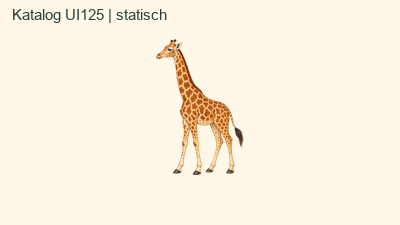

Neutrale Außenfläche und Zwischenräume zwischen Beinen und Schwanz. Geschützt: Vier Beine/Hufe, Fleckenzeichnung auf heller Haut, Ohren, Hörner, Mähne, Wimpern und Schwanzhaare.

- Definition unverändert: `90ac8dfd3a149ee8d82e0d86cb4e81902d978a3d96e73b1e8f667a71776c2f7b`
- Vorgängerbild: `48c36159ee53d5dbcdc0e69b77f7dbdae62598dd31c517788f3f5f3da9f62c33`
- Neue Bilddatei: `1c047af76afe3862377047299624019487fc80ffbaa7bf8993f498b4b4120ee1`
- Zielnotice: `b8f8a0c5d205d5571bc3bd4f2f16a543fb9997b4ee0e0559bc231a245b2acc7d`

[Einzeldatei](../content/authoring/pz-dbbebc72556d4f0c9a37ab69275480e9/at-b-r01/reveal.png) · [Original](../content/authoring/pz-dbbebc72556d4f0c9a37ab69275480e9/at-b-r01/original.png) · [Vergleich und Bestandsraster](../content/authoring/pz-dbbebc72556d4f0c9a37ab69275480e9/at-b-r01/comparison.jpg) · [Kanten](../content/authoring/pz-dbbebc72556d4f0c9a37ab69275480e9/at-b-r01/edges.jpg) · [Großansicht](../content/authoring/pz-dbbebc72556d4f0c9a37ab69275480e9/at-b-r01/large-paper.jpg) · [Katalog UI100](../content/authoring/pz-dbbebc72556d4f0c9a37ab69275480e9/at-b-r01/catalog-ui100.jpg) · [Abschluss UI100](../content/authoring/pz-dbbebc72556d4f0c9a37ab69275480e9/at-b-r01/completion-ui100.jpg) · [Abschluss UI125](../content/authoring/pz-dbbebc72556d4f0c9a37ab69275480e9/at-b-r01/completion-ui125.jpg).

[Freigabevorlage](../content/authoring/pz-dbbebc72556d4f0c9a37ab69275480e9/at-b-r01/approval-proposal.json) · [vollständige Zielnotice](../content/authoring/pz-dbbebc72556d4f0c9a37ab69275480e9/at-b-r01/target-notice.txt) · [Einzelbericht und Grenzen](../content/authoring/pz-dbbebc72556d4f0c9a37ab69275480e9/at-b-r01/report.md) · [ZIP](../content/authoring/pz-dbbebc72556d4f0c9a37ab69275480e9/at-b-r01/package.zip) · [Record mit Paket-/Handoff-/Inventarhash](../content/authoring/pz-dbbebc72556d4f0c9a37ab69275480e9/at-b-r01/record.json).

### 25 · Kölner Dom

ID `pz-e45e2e0d67a34f6aa8368f477454` · vorgeschlagene AT-Bildrevision **1** · Paket `at-b-r01`.

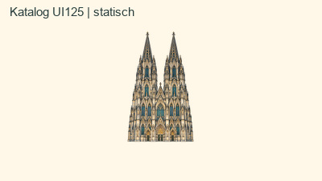

Neutrale Außenfläche zwischen/um Türme und echte Silhouettenlücken. Geschützt: Beide Turmkreuze, Fialen, Maßwerk, helles Mauerwerk, blaue Fenster und Portale in Frontalansicht.

- Definition unverändert: `a21ecffd4b751ed71b97768eb8afa1f96331dc1fb193ccfdf85eeb7797314ef7`
- Vorgängerbild: `8325ef5ee94d88312b968ad058f6cddcf35cda68946db7e9598a97f26ac17998`
- Neue Bilddatei: `5b5b97ec7bdf1965d38f65fe70e5cd51396e7c99454ae1a1390095dfb46e738e`
- Zielnotice: `5f4b68c6d0d2d14eee716d7fa34c58949bc87c678a94f72927c653ff569ddfbe`

[Einzeldatei](../content/authoring/pz-e45e2e0d67a34f6aa8368f477454/at-b-r01/reveal.png) · [Original](../content/authoring/pz-e45e2e0d67a34f6aa8368f477454/at-b-r01/original.png) · [Vergleich und Bestandsraster](../content/authoring/pz-e45e2e0d67a34f6aa8368f477454/at-b-r01/comparison.jpg) · [Kanten](../content/authoring/pz-e45e2e0d67a34f6aa8368f477454/at-b-r01/edges.jpg) · [Großansicht](../content/authoring/pz-e45e2e0d67a34f6aa8368f477454/at-b-r01/large-paper.jpg) · [Katalog UI100](../content/authoring/pz-e45e2e0d67a34f6aa8368f477454/at-b-r01/catalog-ui100.jpg) · [Abschluss UI100](../content/authoring/pz-e45e2e0d67a34f6aa8368f477454/at-b-r01/completion-ui100.jpg) · [Abschluss UI125](../content/authoring/pz-e45e2e0d67a34f6aa8368f477454/at-b-r01/completion-ui125.jpg).

[Freigabevorlage](../content/authoring/pz-e45e2e0d67a34f6aa8368f477454/at-b-r01/approval-proposal.json) · [vollständige Zielnotice](../content/authoring/pz-e45e2e0d67a34f6aa8368f477454/at-b-r01/target-notice.txt) · [Einzelbericht und Grenzen](../content/authoring/pz-e45e2e0d67a34f6aa8368f477454/at-b-r01/report.md) · [ZIP](../content/authoring/pz-e45e2e0d67a34f6aa8368f477454/at-b-r01/package.zip) · [Record mit Paket-/Handoff-/Inventarhash](../content/authoring/pz-e45e2e0d67a34f6aa8368f477454/at-b-r01/record.json).

### 26 · Regenwurm

ID `pz-eedd1fe72af54714908d5b5aff34` · vorgeschlagene AT-Bildrevision **1** · Paket `at-b-r01`.

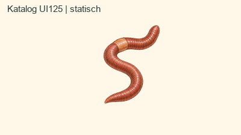

Neutrale Außenfläche inner- und außerhalb des S-Bogens. Geschützt: S-Form, Ringe, helles Clitellum, weiße Glanzpunkte und auslaufende Spitze.

- Definition unverändert: `bfbb38c63bc7bd3e45f10b4ce052d5fb7db6a7304143b907dc7e3ecf538bf6ba`
- Vorgängerbild: `585e51ace5904ad634f4ca3606b4a34aeff05759a1885927da8441f1d5afeef7`
- Neue Bilddatei: `7e2e4f65553be736d5ceb599d66a63f3f742d1f06feb07d76e4958c0330aa52c`
- Zielnotice: `00422523b3c3225b29ee8abe22041a1df5aa5acbd191481fe93db37434765b33`

[Einzeldatei](../content/authoring/pz-eedd1fe72af54714908d5b5aff34/at-b-r01/reveal.png) · [Original](../content/authoring/pz-eedd1fe72af54714908d5b5aff34/at-b-r01/original.png) · [Vergleich und Bestandsraster](../content/authoring/pz-eedd1fe72af54714908d5b5aff34/at-b-r01/comparison.jpg) · [Kanten](../content/authoring/pz-eedd1fe72af54714908d5b5aff34/at-b-r01/edges.jpg) · [Großansicht](../content/authoring/pz-eedd1fe72af54714908d5b5aff34/at-b-r01/large-paper.jpg) · [Katalog UI100](../content/authoring/pz-eedd1fe72af54714908d5b5aff34/at-b-r01/catalog-ui100.jpg) · [Abschluss UI100](../content/authoring/pz-eedd1fe72af54714908d5b5aff34/at-b-r01/completion-ui100.jpg) · [Abschluss UI125](../content/authoring/pz-eedd1fe72af54714908d5b5aff34/at-b-r01/completion-ui125.jpg).

[Freigabevorlage](../content/authoring/pz-eedd1fe72af54714908d5b5aff34/at-b-r01/approval-proposal.json) · [vollständige Zielnotice](../content/authoring/pz-eedd1fe72af54714908d5b5aff34/at-b-r01/target-notice.txt) · [Einzelbericht und Grenzen](../content/authoring/pz-eedd1fe72af54714908d5b5aff34/at-b-r01/report.md) · [ZIP](../content/authoring/pz-eedd1fe72af54714908d5b5aff34/at-b-r01/package.zip) · [Record mit Paket-/Handoff-/Inventarhash](../content/authoring/pz-eedd1fe72af54714908d5b5aff34/at-b-r01/record.json).

## V01-Datei- und Integritätsprüfung

Nach dem Schreiben separat geprüft, ohne den Paketgenerator oder seine
Prüfbehauptungen als Ergebnis zu übernehmen:

- **26/26 ZIPs**, **677 Einträge**, zusammen
  **131812243 Bytes**: sicher geöffnet, CRC geprüft; relative
  eindeutige POSIX-Namen ohne Traversal, absolute Pfade, Laufwerks-/Backslashalias,
  Groß-/Kleinschreibkollision, Verschlüsselung, Link oder ausführbaren Modus.
  Grenzen 128 MiB ZIP, 64 MiB Einzeldatei, 512 MiB entpackt, 2048 Einträge und
  240 Zeichen je Pfad unterschritten.
- Inventar enthält exakt alle Nutzdateien; ausschließlich Handoff und Inventar
  sind wegen Selbstreferenz ausgenommen. Jeder Inhalt mit Größe/SHA-256 geprüft.
  Handoffkopie und alle gesicherten Einzeldateien bytegleich zum geschriebenen ZIP;
  äußerer Record bindet ZIP, Handoff und Inventar. Native PNGs unverändert kopiert.
- Freigabevorlagen, Notices, Bild-/Definitions-/Ansichtshashes und Regelwerksnapshot
  v0.5.0 / Dokumentrevision 21 gegengeprüft. `reveal_review`, Zustimmungen `null`,
  sämtliche Gates `pending`; kein `content_ready` und keine Adapterzertifizierung.
- **373 geschützte getrackte Dateien** unter `game/`
  und `content/` außerhalb Authoring SHA-256-identisch zur eingefrorenen Basis:
  Definitionen, Bilder, Notices, beide Registrys, Slots/Kategorien, Ratings,
  Addedquellen und historische Receipts. Keine neue aktive AT-Quelle.
- Vorhandener Indexeintrag und alle **4 Dateien**
  der fremden Produktion `pz-cc522b3f66bc4d6eafe1f8a387d18d1f/r01` bytegleich zum
  Basiscommit. Unabhängige unversionierte Designarbeit nicht aufgenommen.
- Kein Solver, Proof, Schwierigkeitslauf, realer Katalog-Replay, Plan/Adopt,
  Savezugriff, Merge oder Deployment. Aktive Daten bleiben unberührt.

Die vollständigen per-ID-Pakethashes stehen in den verlinkten Records. Diese
Archivprüfung ist eine Inhalts-/Dateikontrolle, kein neu eingeführter CI-Test.
Arbeits-JPGs und Beschriftungen wurden vor der ersten Vorlage korrigiert;
Textdateien sind LF-stabil gepackt, damit Git die Hashbindungen nicht verändert.

## Akzeptanzzuordnung und aktuelle Pflicht-CI

| Kennung | V01-Nachweis / Grenze |
| --- | --- |
| AT-B-V01-A01 | 26/26 Originalbindungen, unveränderte ID-Menge, Befund/geschützte Merkmale und Disposition in Inventar und Einzelberichten; fremde Arbeit erhalten. |
| AT-B-V01-A02 | Alle 26 tatsächlichen Originale/Kandidaten und Kanten gesichtet; sinnvolle Freistellung und konkrete Szenenvignetten. Native Textur-/Alphagrenzen offengelegt; Eigentümerannahme bleibt offen. |
| AT-B-V01-A03 | Alle Einzeldateien, vollständige Vier-Hash-/Revisions-/Noticebindung, Vergleiche, Bestandsraster und Papierkontexte UI100/125 vorhanden. Statisch ist ausdrücklich von Runtime getrennt. |
| AT-B-V01-A04 | Vollständiger unveränderter geschützter Dateibestand plus Git-Diff; keine aktive Bild-/Metadaten-/Saveänderung. |
| AT-B-V01-A05 | 26 geschriebene ZIPs unabhängig geöffnet, Inhaltsmengen/Hashes/Handoffkopien geprüft; Prompts, Herkunft, Entscheidungen und Index gesichert. |
| AT-B-V01-A06 | Dokumentation, vollständiger Diff, eigene B01-Nacharbeit und lokale Regressionen vorhanden; abschließender aktueller CI-/Selbstreviewnachweis mit Head/Basis/Test-Merge/Run/Versuch in Draft-PR #264. Nur ein dort tatsächlich erfolgreicher finaler Lauf erfüllt A06. |
| AT-B-V01-A07 | Gemeinsame konkrete Freigabevorlage für alle 26 IDs; Draft/offenes Issue, ausdrücklicher Stopp vor Plan/Adopt. |

Der ursprüngliche Bild-/Dokumentdiff wählte ausschließlich Docs und Ergebnisgate.
Die gesondert autorisierte Änderung an `tools/ci_scope.py` und dessen Regressionen
wählt nach unveränderten Regeln **alle Pflichtbereiche**: Docs, Product (alle sieben
nativen Gruppen), Production, Preflight, Web (alle fünf Chromiumgruppen) und
Delivery sowie `ci-required`. `content_only=false`; keine manuelle Abwahl.
Die tatsächliche Auswahl und Ergebnisbindung werden am finalen PR-Lauf anhand
von `ci-plan.json` und dem Ergebnisartefakt kontrolliert. Allgemeine technische
Regressionen sind keine Übernahme oder Nachproduktion der 26 Bestandsrätsel.

### Gesonderte technische Nacharbeit B01

Die ausdrückliche Auftragsergänzung vom 19.10.2026 ist im aktuellen Body von
[#256](https://github.com/venomenon328/picross/issues/256) und in PR #264 gesichert.
Sie betrifft ausschließlich die Verfügbarkeit der vollständigen Diff-Inhalte.
Vor dem bisherigen vollständigen `git diff --check` sammelt der Fetchpfad aus
rohen Tree-Metadaten die Blob-IDs beider Diffseiten. Umbenennungen zählen weiterhin
als Löschung und Neuanlage; Gitlinks sind keine Blobs. Fehlende Objekte werden
ohne implizite Einzelabrufe ermittelt und über einen gebündelten Git-Fetch per
Standardeingabe geladen. Bereits vorhandene Objekte werden nicht erneut angefordert.
Das entspricht dem [Git-Verfahren zum Abruf versprochener Objekte](https://github.com/git/git/blob/v2.51.0/promisor-remote.c)
mit [deaktiviertem Lazy-Fetch bei der Existenzprüfung](https://git-scm.com/docs/git#Documentation/git.txt---no-lazy-fetch).

Whitespace-Prüfung, 90-Sekunden-Prozessgrenze, Jobauswahl, Quellen-/Versuchsbindung
und Ergebnisgate bleiben erhalten. Abruffehler brechen die Auswahl ab. Der reine
Inhaltspfad erreicht den Blobabruf nicht und bleibt ausschließlich metadatenbasiert.
Workflow, aktive Bilder, alle Authoringdateien und deren Hashbindungen sind von
dieser Nacharbeit unverändert.

Lokale Selektor-/Gate-Suite: **35 Tests bestanden**, einschließlich vier neuer
Regressionen mit echten lokalen partiellen Git-Clones und ausschließlich festen
synthetischen Dateien. Geprüft sind beide Diffseiten, Löschung, Umbenennung mit
Leerzeichen, Binärdatei und 64 neue Texte in einem Abruf; unveränderte Dateien
bleiben fehlend, der zweite Lauf benötigt keinen Blob-Fetch. Ein echter
Whitespacefehler im Rootvergleich bleibt Exitcode 2 (leere und Null-Basis),
fehlende Remoteobjekte bleiben fatal, reine Inhaltspakete bleiben ungeholt.
Der erste lokale Implementierungsversuch scheiterte am noch unvollständigen
Fetchaufruf; erst die korrigierte Variante bestand diese Proben. Kein früherer
Fehllauf wird als Erfolg gezählt. Aktuelle Remoteergebnisse folgen im PR-Nachweis.

Lokal bestanden: `git diff --cached --check`, Dokumentvalidator auf einer frischen
vollständigen Kopie des Git-Index und Bytevergleich aller 729 neuen Authoringdateien
zwischen Index und Arbeitsbaum (sämtlich 100644). Der erste unbereinigte lokale
Dokumentlauf erfasste auch ignorierte Altartefakte/venvs und scheiterte daran;
er wird nicht als Pass ausgegeben. Keine fremden Dateien wurden dafür geändert.
Tatsächlich ausgeführte Remote-CI wird im PR mit ihrem Stand dokumentiert.
Das getrennte Selbstreview
prüft den tatsächlichen Gesamtdiff, Original-/Archivbindungen, Abnahmegrenzen und
CI-Artefakte; es ist keine unabhängige AT-B-R01-Prüfung.

## Offene Gates und erlaubte Wiederaufnahme

| Gate | Akteur / Zeitpunkt / Stand |
| --- | --- |
| Bild-/Endfreigabe aller 26 IDs | Eigentümer nach dieser Vorlage, vor jedem produktiven Request/Plan/Adopt; alle drei Zustimmungen je ID offen. |
| AT-B-T01 | Späterer ausdrücklich beauftragter Integrationsschritt: echte Übernahme, identischer No-op, Datei-/Invariantenkontrolle und tatsächliche Katalog-/Abschlussdarstellung; nicht ausgeführt. |
| AT-B-R01 | Qualifizierte separate finale Inhalts-/Integrationsprüfung vor Merge; nicht ausgeführt. |
| Merge / Issue-Abschluss | Neuer passender Auftrag nach erfüllten Gates; V01 bleibt Draft, #256 bleibt offen. |

Zur Wiederaufnahme zuerst aktuellen Branch, Issue, Originalbindungen und Record-
Hashes prüfen. Nach einer tatsächlichen Eigentümerentscheidung deren Akteur,
UTC-Zeitpunkt, Erklärung und die konkreten unveränderten Dateibindungen sichern.
Erst mit passendem Folgeauftrag dürfen die freigegebenen PNGs hashgleich in den
externen Eingang des vorhandenen AT-A-Wegs gelangen. Keine manuelle Livekopie und
kein Wiederverwenden einer Zustimmung für geänderte Bytes. Grenzen/ggf. notwendige
sequentielle Teilmengen richten sich nach Issue #256 V4 und dem vorhandenen Vertrag.
