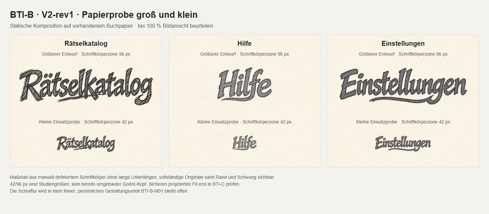

# BTI-B-T01 · V2-rev1 · 06.11.2026

Gezielte Musterrevision gemäß [BTI-B-D03 / A06–A09](https://github.com/venomenon328/picross/issues/533#bti-b-d03), zu Draft-PR #534. Produkt-Head unverändert `51e58889583ccd6eeb40d21db1c09a0ff55a8433`. Diese Dateien liegen ausschließlich auf dem temporären Ref `review/533-bti-b-v2r1`; keine Produktintegration. Eigentümerabnahme **BTI-B-M01 offen**.

## Die drei Kandidaten

- [Rätselkatalog: Original](originals/catalog.png) — der verbindliche V2-Anker, bytegleich.
- [Hilfe: Original](originals/help.png) — gröbere offene Schraffur; ein durchgehender linkswärts gebogener Zug aus dem unteren f-Ende.
- [Einstellungen: Original](originals/settings.png) — gröbere Schraffur; ein durchgehender längerer Links­zug aus dem unteren g-Bogen.

[Neutrale Familienansicht](family.png) · [Papier groß/klein](paper.png) · [V2 vorher/nachher](before-after.png)

Die Originale sind verlustfreie RGBA-PNGs, unveränderte Generatorausgaben beziehungsweise unveränderter Kataloganker. GitHubs Text-Contents-Schnittstelle ist für diese Dateien über 1 MiB kein ausreichender Originalweg. Auf der jeweiligen Dateiseite **Raw/Download** verwenden; der PR-Lieferkommentar enthält unveränderliche direkte Binärlinks. Nur zwei alte V2-Originale in `before/` dienen dem kompakten Vorher/Nachher-Vergleich, keine neue Neunergalerie.

## Gemeinsamer Stilbrief

Leicht geneigte, individuell gezeichnete Graphitbuchstaben mit kräftigen, unregelmäßig nachgezogenen Konturen. Breite Striche enthalten sichtbare grobe diagonale Schraffur mit offenen Zwischenräumen; keine flächig schwarze Füllung, keine reine Rauschtextur. Strichdruck, Buchstabenhöhe, Grundlinie und Abstände variieren leicht. Dunkles neutrales Graphit auf transparentem Grund, keine dominante Sepiafarbe. Transparente Innenräume und vollständige Enden. Wortproportionen bleiben natürlich: kurze Wörter werden nicht auf Langwortbreite gestreckt. Nur Lettering; keine Banner, Rahmen, Bildobjekte oder zusätzlichen Zierunterstriche.

Maßstab ist das **tatsächlich geöffnete und als Bildreferenz eingesetzte V2-Katalogoriginal**, insbesondere seine offenen diagonalen Striche und rauen Konturen. Wortabhängige Querzüge sind Fortsetzungen geeigneter Buchstaben: f unten nach links, g unten nach links; kein separater zweiter Strich. Beim Katalog bleibt die bestehende Behandlung erhalten. Für spätere Erweiterungen dieselben Originalreferenzen plus exakte Zielorthografie verwenden und die sichtbare Körperhöhe vergleichen. Prompts oder Seeds garantieren keine identischen Pixel.

## Tatsächliche Erzeugung und Herkunft

[generation.json](generation.json) enthält die **vier tatsächlichen vollständigen Prompts**, Referenzreihenfolge, bekannten Parameter, Ausgabedateinamen und SHA-256. Werkzeug: eingebautes `image_gen.imagegen`, jeweils `transparent_background=true`. Backend-/Modellversion, Seed und nicht exponierte Parameter sind unbekannt.

1. G1: Katalog + bisherige Hilfe als Referenzen → neue Hilfe, geliefert.
2. G2: Katalog + bisherige Einstellungen → erste Revision; wegen noch zu dichter, gleichmäßiger Schraffur verworfen.
3. G3: Katalog + neue Hilfe + G2 → offene gröbere Schraffur; wegen schwebender heller Sprenkel außerhalb des Wortes verworfen.
4. G4: G3 → generative Bereinigung dieser Sprenkel, geliefert. Kein Anspruch einer pixelidentischen deterministischen Freistellung.

Die beiden verworfenen Zwischenbilder werden nicht als weitere Auswahlkandidaten aufbewahrt; ihre Identität und Bearbeitungsschritte sind dokumentiert. Keine manuelle Rasterretusche, Neufärbung, Alphaersetzung, Beschneidung oder Neucodierung der gelieferten Originale. Keine TTF-Rasterung und keine fremden Lettering-Downloads. Die V2-Ausgangsbilder stammen aus der bereits dokumentierten BTI-B-Erstproduktion, Commit `ee4938b347e51ddc2d2d5a5e8f9a10780cecfb0f`. Die ursprüngliche C-Chatreferenz bleibt dort Herkunft, hier ist der gebundene Kataloganker die direkte Bildreferenz. Keine Behauptung exklusiver Rechte.

## Maße und Vergleichsbasis

| Original | Pixel | Byte | SHA-256 |
| --- | --- | ---: | --- |
| catalog.png | 2172 × 724 | 1814749 | `0931abd9e2b67211b6895575f7ab157d10547348d62d2e99c4ba067ee4772cc4` |
| help.png | 1536 × 1024 | 2500745 | `5ae830d1fe70007c67ed04570c034b446a3007c8ec78676cc335875bf3f8e87a` |
| settings.png | 2172 × 724 | 1427565 | `d4c84fbe95279c51e1a07df9511e3482b3d65591942d1849655c2ef8dc452c75` |

`preview-metrics.json` bindet jede Anzeigegröße und Skalierung an das Original. Manuell gewählte Schriftkörperzonen (ohne lange Unterlängen) sind Katalog y=75…570 (495 px), Hilfe 105…900 (795 px), Einstellungen 80…600 (520 px). Das sind nachvollziehbare optische Kompositionshilfen, keine automatische exakte Versalhöhenmessung. Die komplette PNG-Fläche wird gleichmäßig in beiden Achsen skaliert; kein Zuschneiden und kein Strecken.

| Wort | Große PNG-Anzeige (Körperzone 96 px) | Kleine PNG-Anzeige (Körperzone 42 px) | Sichtbare Tintenhöhe groß / klein¹ |
| --- | --- | --- | --- |
| Rätselkatalog | 421,236 × 140,412 px | 184,291 × 61,430 px | 115,782 / 50,655 px |
| Hilfe | 185,479 × 123,653 px | 81,147 × 54,098 px | 103,608 / 45,328 px |
| Einstellungen | 400,985 × 133,662 px | 175,431 × 58,477 px | 111,508 / 48,785 px |

¹ Alpha ≥16 einschließlich Punkten und Unterlängen. Vorher/Nachher verwendet jeweils 80 px Körperzone; genaue Werte ebenfalls in der Metrikdatei. Die kleine Papierprobe ist die zu beurteilende Einsatzstudie, keine bereits geprüfte Godot-Pixelgröße.

Die drei mitgelieferten HTML-Dateien zeigen die Originale ohne Filter. Gerendert mit Microsoft Edge 156.0.4314.58, headless, Gerätemaßstab 1: Familienansicht 1480×470, Papier und Vergleich je 1480×650. Vorhandenes `game/book/paper.png` am Produkt-Head (SHA-256 `1af9f61957619d7cea98b69021688b0b78997d84baf93698c9f02dcbb866362f`, Herkunft `game/book/paper.json`) plus 53,3 % Weißüberlagerung. Keine echte 3D-Buchprojektion oder Shadernachbildung. Zum lokalen HTML-Öffnen den Reviewcommit auschecken, damit der relative Papierpfad verfügbar bleibt.

## Technischer Nachweis und getrenntes Selbstreview

Einmalige lesende Bildprüfung mit Python/Pillow 12.3.0: alle drei PNGs vollständig decodiert, RGBA, transparente Pixel vorhanden, keine signifikanten Striche am Rand (Alpha ≥16), Enden visuell vollständig. Alpha-Minimum jeweils 0, Maximum Katalog/Einstellungen 255, Hilfe 254; volle Deckkraft 255 ist keine Transparenzvoraussetzung. Exakte Werte in [image-checks.json](image-checks.json). RGB ist nicht in jedem Antialiaspixel exakt gleich; maximaler sichtbarer Kanalunterschied 32/7/29. Die Farbentscheidung ist visuell neutrales Graphit, keine erfundene automatische Neutralitäts-/Schönheitsmetrik. Katalog und zwei Vorher-Dateien sind bytegleich mit den gepinnten Vorlagen; neue Originale bytegleich mit G1/G4. [manifest.json](manifest.json) bindet alle Lieferdateien mit Bytes und SHA-256. Der abschließende binäre Rückdownload und die erneute Bildöffnung sind im PR-Lieferkommentar am unveränderlichen Commit protokolliert.

**Selbstreview des Implementierers, keine unabhängige Abnahme:**

- **A06:** Gemeinsame diagonale Graphitschraffur ist gegenüber den dichten alten Hilfe-/Einstellungen-Füllungen geöffnet und gröber; Katalog bleibt unverändert. Vergleich bei gleicher definierter Körperhöhe, natürliche Wortbreiten. Verbleibende gestalterische Differenz: Katalog wirkt kantiger und stärker unregelmäßig nachgezogen, Hilfe/Einstellungen etwas ruhiger. Ob die Annäherung als dieselbe Zeichenhand überzeugt, bleibt persönliches Urteil in M01.
- **A07:** Hilfe: unterer f-Zug durchgehend nach links unter die vorderen Buchstaben. Einstellungen: unterer g-Bogen durchgehend nach links bis etwa s/t. Keine zusätzlichen abgelösten Doppelstriche; die unterschiedlichen Längen sind beabsichtigt. Kein erkannter Lesbarkeitskonflikt, daher keine technische Ausnahme beansprucht.
- **A08:** Drei exakte Wörter, ä-Punkte, i-Punkte und zwei l in Einstellungen am Original und groß/klein kontrolliert. Vollständige Strichenden, transparente Ränder, lesbare kleine Ansichten und sichtbare, dort feinere Schraffur. Alle geforderten Originale/Vergleiche zugestellt. Kein Spiel-Fit behauptet.
- **A09:** Tatsächlich geöffneter/gehashter Kataloganker in den referenzgestützten Aufrufen; Herkunft, gemeinsamer Brief, Prompts, Zwischenverlauf und Originalhashes dokumentiert.

`modules=[]`; keine neuen Dauerprüfungen. Nur Muster-/Metadaten-/Scopeprüfung, statische HTML-Bildausgabe und Binärzustellung. Keine neue Runtime-/Package-CI, kein Windows-Spieler, kein Chromium-Spieltest. Godot-Fit, UI100/125, Exporte, Navigation und Saves gehören erst zur separat zu beauftragenden BTI-C-Integration. Der alte BTI-A-Produktdiff samt Paketplan bleibt unverändert; frühere CI ist kein neuer Nachweis.

## Befristete Zustellung und nächster Schritt

Empfänger: Eigentümer von picross und anschließender Reviewer in PR #534. Aufbewahrung dieser Lieferung und benötigter alter V2-Referenzen bis **13.11.2026** (sieben Tage nach Zustellung). Vor Rücknahme bei weiter offenem Gate erforderlichen Zugang erneuern. Der temporäre Reviewref wird nicht in main gemergt; seine spätere Entfernung ist ein eigener nachvollziehbarer Abschluss, kein automatischer Löschschritt dieser Lieferung.

Jetzt revidierte Originale plus beide Papiermaßstäbe persönlich prüfen und **BTI-B-M01 für V2-rev1** freigeben oder konkrete Änderungen nennen. V2 als Richtung ist bereits entschieden. Anschließend erst BTI-C gesondert vorbereiten/beauftragen. Kein Merge.
