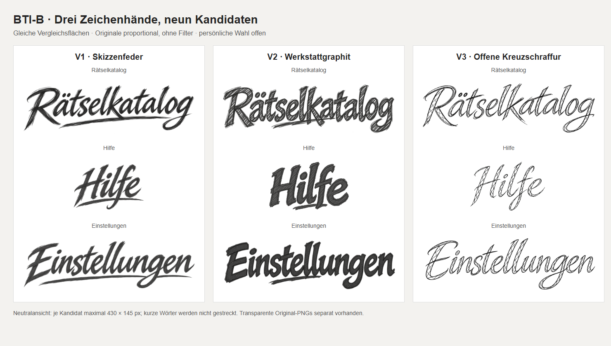

# BTI-B · Neun Schriftzugkandidaten zur persönlichen Auswahl

Lieferdatum 06.11.2026. Entscheidung: [Issue #533, BTI-B](https://github.com/venomenon328/picross/issues/533).
Produktbindung: Draft-PR #534, unverändert `51e58889583ccd6eeb40d21db1c09a0ff55a8433`.
Dieser separate Reviewref enthält ausschließlich befristete Muster. Kein Produktmerge,
keine aktiven Titeländerungen, keine neue Runtime-/CI-Produktion und keine Stilwahl.
Bereitstellung bis **13.11.2026** für Eigentümerentscheidung **BTI-B-M01**.
Bei bis dahin offener Wahl Zustellung/Aufbewahrung gezielt erneuern; Rücknahme des
Reviewrefs erst im beauftragten Abschluss. Die zurückgewiesene BTI-A-Stilwahl wird
durch diese Lieferung nicht wieder freigegeben.

## Vergleich zuerst

[Alle neun Kandidaten auf gleicher neutraler Fläche](comparison.png).
Jede Variante enthält unabhängig gezeichnete Wörter `Rätselkatalog`, `Hilfe`,
`Einstellungen`; das kurze Wort wird nicht auf die Langwortbreite gestreckt.

**Papieransichten bei 100 % öffnen**, damit die kleinen Proben nicht unbemerkt
vergrößert werden. Jeweils alle drei Titel, oben größerer Zielentwurf,
darunter die kleine Einsatzprobe:

- [V1 · Skizzenfeder, groß und klein](V1-paper.png)
- [V2 · Werkstattgraphit, groß und klein](V2-paper.png)
- [V3 · Offene Kreuzschraffur, groß und klein](V3-paper.png)

Die Vergleichstafel ist 1480 × 840 px; Papieransichten sind 1480 × 620 px.
Neutrale Vergleichsbox je Wort maximal 430 × 145 px; Papier-Zielentwurf
maximal 430 × 110 px, kleine Probe maximal 300 × 65 px. Alle Bilder verwenden
proportionale Anzeige der vollständigen Originaldateien, ohne Filter oder Ausschnitt.
Bei den langen 3:1-Dateien ergibt das auf Papier 330 × 110 bzw. 195 × 65 px;
Hilfe 165 × 110 bzw. etwa 98 × 65 px. Sichtbare Tinte ist wegen transparenter
Ränder etwas kleiner; genaue Hüllen stehen im Manifest.

Diese deutlich verkleinerten Proben zeigen echte Kandidatenpixel in einem
plausiblen größeren Buchkopfmaßstab. Die vorhandene BTI-A-Katalogrolle hat
45 × UI Kopfhöhe und höchstens 37 px Tintenfläche bei UI100. Die endgültige
BTI-C-Geometrie ist nicht entschieden: sichere projizierte Fläche, mögliche
Umverteilung und sämtliche Runtime-/Resize-/Navigationsbelege folgen erst nach
persönlicher Stilwahl und gesondertem Auftrag. **Statische Komposition, kein
Screenshot einer neuen Spielimplementierung.**

## Unveränderte Original-PNGs

Die Links öffnen die vollständigen Dateien; auf GitHub **Download raw file**
verwenden. Ein verkleinertes GitHub-Vorschaubild ersetzt keinen Originaldownload.
Alle PNGs besitzen echte Alpha; weiße/papierfarbene Vergleichsflächen sind nur
Teil der separaten HTML-Komposition. Größe, Bytezahl, SHA-256 und Alphahülle:
[manifest.json](manifest.json).

| Variante | Rätselkatalog | Hilfe | Einstellungen |
| --- | --- | --- | --- |
| V1 | [Original](originals/V1-catalog.png) | [Original](originals/V1-help.png) | [Original](originals/V1-settings.png) |
| V2 | [Original](originals/V2-catalog.png) | [Original](originals/V2-help.png) | [Original](originals/V2-settings.png) |
| V3 | [Original](originals/V3-catalog.png) | [Original](originals/V3-help.png) | [Original](originals/V3-settings.png) |

Die neun originalen Erzeugnisse wurden außerdem direkt im Auftrag als Bilder
ausgegeben, die vier Vergleichsbilder im Bildbetrachter geöffnet. Der PR-Lieferkommentar
bindet den konkreten Belegcommit und den tatsächlich geprüften binären Rückdownload.
Dateien über 1 MiB können im textgebundenen GitHub-Contents-Connector keinen
Base64-Inhalt liefern; deshalb sind Originaldownload/Git und die direkte
Bildausgabe die vorgesehenen Wege. Die unter 1 MiB großen Vergleichs-PNGs sind
zusätzlich für die übliche GitHub-Bildansicht geeignet. Das belegt Zustellung,
nicht die noch ausstehende persönliche Sichtung oder Auswahl.

## Drei Stilbriefe

### V1 · Skizzenfeder

Grammatik: deutlich rechtsgeneigte, zugespitzte freie Schrift mit offenen
Großbuchstaben, wechselnden Neigungen/Höhen und aus mehreren Strichen aufgebauten
Abstrichen. Längsstrichelung, nachgezogene Kanten und ein langer flacher Schwung
geben die Zeichenhand vor. Neutrales Anthrazit. Gleiche Grammatik für kurze und
lange Wörter; keine horizontale Streckung.

Stärken: nahe am energischen Duktus des ursprünglichen C-Bildes; kräftige
Silhouette und gut lesbare kleine Wörter. Grenze: in der kleinen Probe verdichten
sich feine Längsstriche; die Handschrift wirkt dann vor allem über Kontur und
Schwung. Gegenüber BTI-A spitzere Formen, gebrochene Kanten, weniger runde
Schmuckschlaufen, neutralgraue statt brauner Tinte.

### V2 · Werkstattgraphit

Grammatik: breitere, aufrechtere und teils kantige Formen mit offenen Innenräumen,
stärkerem Gewicht und sichtbarer diagonaler Schraffur. Stumpfere Enden, ungleiche
Bögen und kurze zentrale Querstriche statt langer eleganter Unterstreichung.
Die nachgezogenen Umrisse sollen wie von Hand aufgebaut wirken.

Stärken: markante kleine Silhouette; besonders im Katalogwort klare Schraffur.
Grenze: Hilfe/Einstellungen wirken durch ihre dichteren Striche dunkler als das
Katalogwort; das ist in der Vergleichstafel offen sichtbar. Deutlich massiver
und weniger fließend als BTI-A, ohne die braune Tinte oder polierten Schlaufen.

### V3 · Offene Kreuzschraffur

Grammatik: offene, teils doppelte Federkonturen, dünne schwarze Verbindungen und
breitere Striche, die nur mit wenigen kreuzenden Linien gefüllt werden. Viel
Transparenz innerhalb der Buchstabenstriche; ungleicher Rhythmus und variierte
Anschlüsse. Querbewegung vor allem in den Buchstaben selbst statt als schwerer
Unterstrich.

Stärken: Schraffur/Konstruktionslinien sind auch verkleinert erkennbar;
größte Distanz zur gefüllten BTI-A-Bürstenschrift. Grenze: sichtbar leichteres
Gesamtgewicht, insbesondere Hilfe in der Kleinprobe. Die Abwägung zwischen
Leichtigkeit, Kontrast und kräftigerer Titelwirkung bleibt beim Eigentümer.

## Herstellung, Referenzen und Rechte

Neun Aufrufe des eingebauten `image_gen.imagegen`, je ein Original pro Titel.
`transparent_background=true`. Modell-/Backendversion, Seed und interne
Samplingparameter wurden nicht offengelegt; keine behauptete pixelidentische
Reproduzierbarkeit. Alle tatsächlich verwendeten Prompts, bekannten Parameter,
Referenzzuordnungen und Originaldateinamen stehen in [generation.json](generation.json).

Der Eigentümeranhang des aktuellen Auftrags ist die tatsächlich betrachtete und
an Imagegen übergebene Referenz C: der breite Katalogschriftzug auf warmem Papier,
im Chat als 656 × 161 px gezeigt. Seine Originaldatei war nicht als lokaler Pfad
verfügbar; daher kein erfundener Dateihash oder angeblich byteidentischer Nachbau.
V1 wurde mit diesem Gesprächsbild erzeugt. V2/V3 erhielten C und die bereits
erzeugten Katalogkandidaten als ausdrücklich bezeichnete Kontrastbeispiele.
Hilfe und Einstellungen referenzieren jeweils nur ihr eigenes Katalogoriginal.
Die abgelehnten BTI-A-Bilder wurden zur Abgrenzung betrachtet, nicht als
Generator-Stilanker verwendet.

KI-erzeugte Muster auf ausdrücklichen Eigentümerauftrag und dessen Bildreferenz.
Keine Fremdfonts rasterisiert, keine fremden Kunstassets recherchiert, keine
Behauptung einer menschlichen Urheberschaft oder ausschließlicher Rechte.
Keine Retusche, nachträgliche Freistellung, Textkorrektur, Umfärbung, Beschneidung
oder Neukodierung der neun Originale. Sie sind zugleich Master und Vorschauassets.

Die statischen Tafeln verwenden die unveränderten PNGs als HTML-Bildelemente;
HTML-Quellen liegen daneben. Bildausgabe mittels lokalem Microsoft Edge headless,
Device Scale Factor 1. Keine Spiel-/Chromium-Testfamilie ausgeführt und keine
neue Website veröffentlicht. Papier stammt aus dem vorhandenen
`game/book/paper.png`, SHA-256
`1af9f61957619d7cea98b69021688b0b78997d84baf93698c9f02dcbb866362f`,
mit 53,3 % weißer CSS-Aufhellung für diese statische Vergleichsfläche;
Herkunft unverändert in `game/book/paper.json`. Dies simuliert warmes Spielpapier,
nicht den vollständigen 3D-Materialshader.

## Technische und visuelle Prüfung

- Exakt neun PNGs, drei eindeutige Varianten mit allen drei Wörtern.
- Alle neun Originale und beide Vergleichsmaßstäbe betrachtet: Wörter,
  Umlautpunkte, beide l in Einstellungen und komplette Strichenden kontrolliert.
- RGBA, transparente Außenflächen und Innenräume geprüft; keine deckende
  Papierplatte. Einige Generatororiginale besitzen vereinzelte kaum deckende
  Randpixel. Die sichtbare Tinte ab Alpha 16 liegt bei allen Dateien vollständig
  innerhalb der Bildgrenzen; Originale wurden deshalb nicht beschnitten.
- Neutrale Tinte statt dominanter Sepiafarbe; keine zusätzlichen Bildobjekte.
- Byteidentität nach Kopie und binärem Rückdownload prüfen; Ergebnisse bindet
  der PR-Lieferkommentar. Kein Laufzeit-/Export-/CI-Erfolg aus diesen Bildern.

**Stopp:** BTI-B-M01 bleibt offen. Der Eigentümer wählt ausdrücklich V1, V2 oder V3
oder benennt konkrete Änderungen. Keine Rangfolge oder automatische Auswahl
durch Codex, kein Integrationsauftrag für BTI-C und kein Merge.
